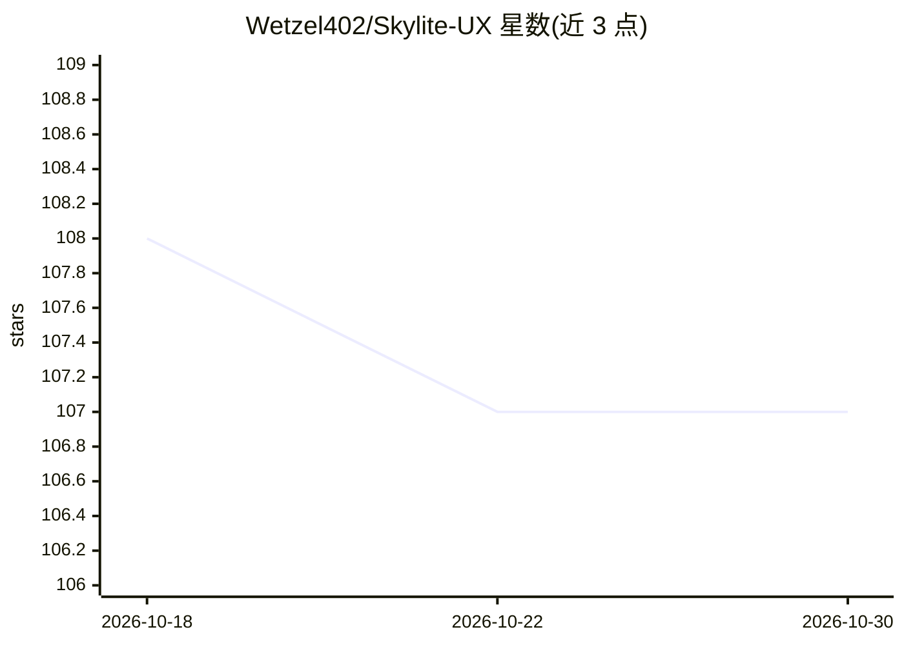

# Wetzel402/Skylite-UX

⭐ 107 · TypeScript · AGPL-3.0 · 推送 2026-10-28 · [GitHub](https://github.com/Wetzel402/Skylite-UX) · [官网](https://wetzel402.github.io/Skylite-UX/) · 组织维护

**自托管家庭管理应用：日历、待办与购物清单**

开源自托管的家庭管理平台，定位为商业家庭管理服务的替代：用户自带硬件、无订阅费用，提供家庭日历、待办清单、购物清单与用户管理功能，餐饮规划尚未实现。技术栈为 Nuxt/Nuxt UI/TailwindCSS/Prisma/PostgreSQL，通过 Docker 分发。项目声明使用 AI 辅助开发工具，并在贡献指南中说明 AI 生成代码的审查流程。采用 MIT 许可证。

## 筛选速览

| 维度 | 判定 | 备注 |
|---|---|---|
| AI 角色 | `ai-enhanced` | 去掉 AI 部分产品仍成立 |
| 许可风险 | `viral` | AGPL-3.0 |
| 部署形态 | `self-host` | docker 或自建部署 |
| 模型依赖 | — | README 未给出锁定关系 |
| 硬件要求 | — | 无带数字的原话,不猜 |
| 安装摩擦 | `low` | 无编译、无系统依赖或容器化 |
| 成熟度 | — | 结构信号不足 |

## 能力要点

- 家庭日历、待办清单、购物清单与用户管理
- 自托管、自带硬件、无订阅的模式
- Nuxt/Prisma/PostgreSQL 技术栈，Docker 分发
- 声明使用 AI 辅助开发并公开代码审查流程

## 适用场景

- 在自家服务器上管理家庭日历与待办
- 与现有自托管服务（如 Home Assistant）搭配使用
- 替代带订阅的商业家庭管理产品

## 场景标签

 · 领域:自托管家庭管理应用

## 证据(README 行号)

> L23: Skylite UX was conceived as an open source, self-hosted alternative to commercial family managers. Most commercial 
> L25: Built with AI-assisted development tools. See our contributing guide for how we use and review AI-generated code.

## 星数曲线

2026-10-18 108 → 2026-10-30 107（-1）

---
*卡片 v1 · prompt 1.4 · 生成 2026-10-23 · 置信度 mid · 依据 README sha `9ef89fbb1d4d` · [字段定义](../../DATASET.md)*
