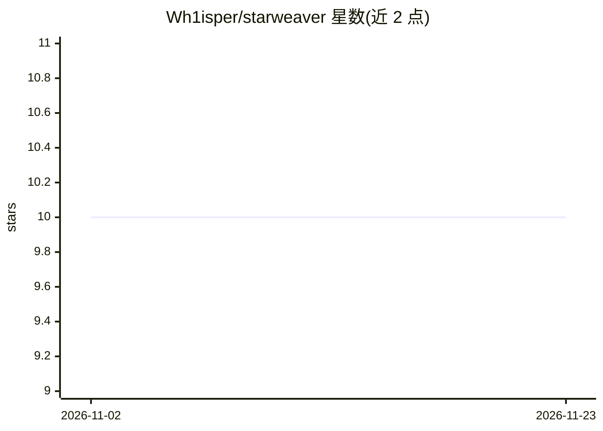

# Wh1isper/starweaver

⭐ 10 · Rust · BSD-3-Clause · 推送 2026-08-13 · [GitHub](https://github.com/Wh1isper/starweaver) · [官网](https://starweaver.wh1isper.top) · 个人维护

**Rust 语言的本地优先 Agent 开发 SDK 与 CLI 工具集**

以 Rust workspace 组织的 agent 开发套件：提供类型化 agent 循环（AgentBuilder/AgentApp/AgentSession）、provider 无关的模型协议、Serde/schemars 派生的函数工具、JSON Schema 结构化输出与校验重试、checkpoints/会话记录/SQLite 存储等持久化原语。产品形态包括 Rust 与 Python SDK、CLI 启动器、独立 JSON-RPC host，以及 opt-in 的 macOS Computer Use 工具族（桌面端 Tauri 应用为实验性 WIP，暂停维护）。面向构建本地 AI agent、CLI 与服务运行时的开发者。

## 筛选速览

| 维度 | 判定 | 备注 |
|---|---|---|
| AI 角色 | `ai-ecosystem` | LLM/agent 周边工具 |
| 许可风险 | `permissive` | BSD-3-Clause |
| 部署形态 | `None` |  |
| 模型依赖 | — | README 未给出锁定关系 |
| 硬件要求 | — | 无带数字的原话,不猜 |
| 安装摩擦 | `low` | 无编译、无系统依赖或容器化 |
| 成熟度 | — | 结构信号不足 |

## 能力要点

- 类型化 agent 循环、provider 无关模型协议与流式 parts
- Serde/schemars 函数工具、工具集、审批与重试机制
- 持久化执行基础：context 导出/恢复、checkpoints、SQLite 存储适配器
- 独立 JSON-RPC host 与 IDL 优先的 host 协议代码生成

## 适用场景

- 用 Rust 构建本地优先的 AI agent 与服务运行时
- 通过 Python SDK 在 Python 项目中嵌入 agent 能力
- 开发需要持久化会话、回放与检查点的 agent 应用
- 在 macOS 上构建带 Computer Use 观察与输入能力的 agent

## 场景标签

`Agent 框架` · 领域:Agent 开发

## 证据(README 行号)

> L3: Starweaver is a Rust agent SDK for building local-first AI agents, CLIs, and service runtimes.
> L15: - Rust-native agent construction with `AgentBuilder`, `AgentApp`, and `AgentSession`.

## 星数曲线

2026-11-02 10 → 2026-11-23 10（+0）

---
*卡片 v1 · prompt 1.4 · 生成 2026-11-20 · 置信度 high · 依据 README sha `f90b363d71d7` · [字段定义](../../DATASET.md)*
