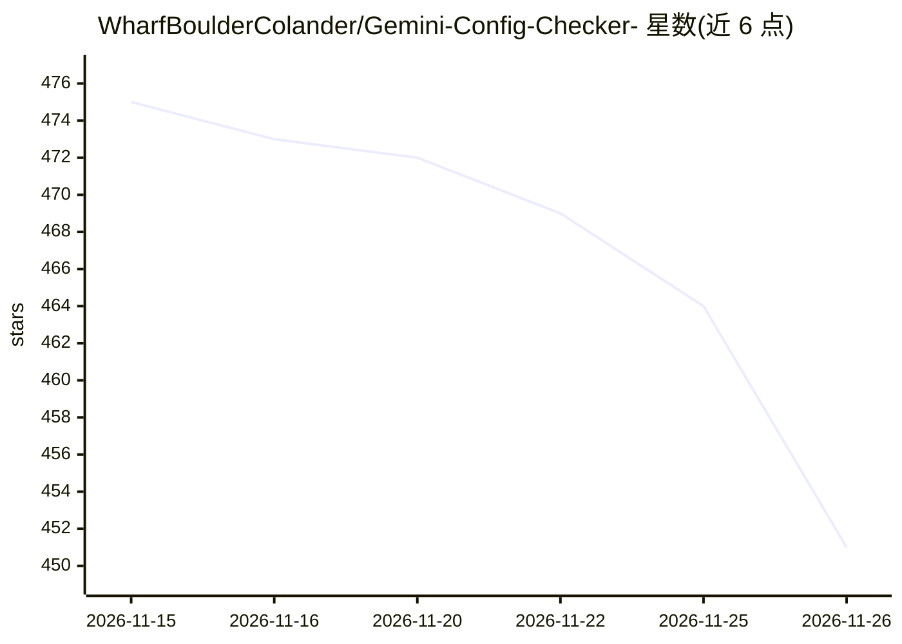

# WharfBoulderColander/Gemini-Config-Checker-

⭐ 451 · Makefile · Apache-2.0 · 推送 2026-11-15 · [GitHub](https://github.com/WharfBoulderColander/Gemini-Config-Checker-) · 个人维护

**扫描代理配置能否访问 Google AI Studio/Gemini 的桌面工具**

基于 Wails 的原生桌面应用（含 Web 服务器与 Android APK 形态），用于批量测试代理配置（vless/vmess/trojan/ss、订阅 URL、base64）能否真正进入 Google AI Studio 和 Gemini。核心机制：以已登录 Google 账号的浏览器逐个验证区域封锁（非单纯连通性探测），内置 Xray-core 引擎与可编辑的 anti-DPI 参数配置；提供 Simple/Advanced 两种模式，Advanced 支持基础配置链式挂载免费配置。版本 0.1.0 自称早期预发布，macOS/Linux/Android 构建未经真机验证。

## 筛选速览

| 维度 | 判定 | 备注 |
|---|---|---|
| AI 角色 | `ai-enhanced` | 去掉 AI 部分产品仍成立 |
| 许可风险 | `permissive` | Apache-2.0 |
| 部署形态 | `desktop` | 安装包/桌面程序 |
| 模型依赖 | — | README 未给出锁定关系 |
| 硬件要求 | — | 无带数字的原话,不猜 |
| 安装摩擦 | `medium` | 含编译或系统依赖之一 |
| 成熟度 | `idea` | |

## 能力要点

- Simple/Advanced 双模式：直测自有配置或将免费配置链式挂在基础配置后
- 以已登录浏览器的 Google 页面判定区域封锁，支持导出 Xray 链式配置
- 内置 Xray-core 与可编辑 anti-DPI 配置（Finalmask/ALPN/密码套件）
- 覆盖 Windows/macOS/Linux 桌面端、Web 服务器与 Android APK（仅连通性模式）

## 适用场景

- 批量验证手头代理配置哪些能访问 AI Studio 和 Gemini
- Cloudflare 配置可连但出口被 Google 封锁时，链式寻找可用出口
- 受限网络下配合 anti-DPI 配置测试 Cloudflare 配置连通性

## 场景标签

 · 领域:网络代理/工具

## 证据(README 行号)

> L11: Find proxy configs that actually get you into **Google AI Studio and Gemini**, by testing each one the way a person
> L14: > **Version 0.1.0, early pre-release.** It works end to end on Windows (the only platform it has been run on so far
> L62: Get the build for your system from the Releases page. Every release ships `SHA256SUMS.txt`.

## 星数曲线

2026-11-15 475 → 2026-11-26 451（-24）

---
*卡片 v1 · prompt 1.4 · 生成 2026-11-17 · 置信度 high · 依据 README sha `846e83cebb20` · [字段定义](../../DATASET.md)*
