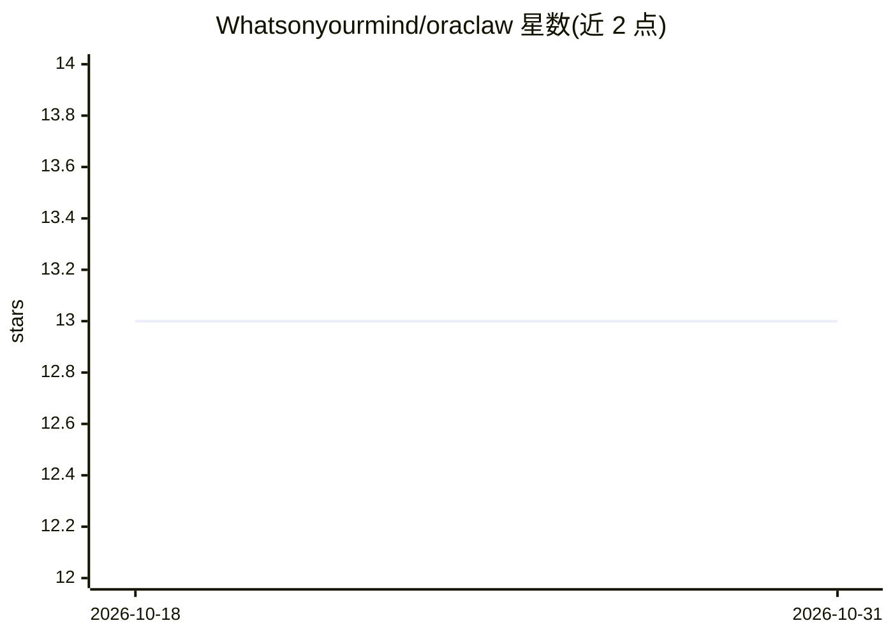

# Whatsonyourmind/oraclaw

⭐ 13 · TypeScript · MIT · 推送 2026-10-21 · [GitHub](https://github.com/Whatsonyourmind/oraclaw) · [官网](https://web-olive-one-89.vercel.app) · 个人维护

**给 AI agent 提供确定性优化算法的 MCP 服务器（17 个工具）**

通过 Model Context Protocol 向 AI agent 提供确定性数值工具的 MCP 服务器，含 17 个工具：bandit/LinUCB、HiGHS LP/MIP 求解、PageRank、蒙特卡洛、CMA-ES、ARIMA/Holt-Winters 预测、VaR/CVaR 风险分析、共形校准等，返回结构化 JSON，官方称响应低于 25ms。免费层 11 个工具（25 次/天/IP，无需 key），高级层 6 个工具需 API key 或 x402 USDC 按次付费。另提供托管 REST API、14 个 npm SDK 包与 LangChain 集成。限制：高级工具依赖付费或按次支付。

## 筛选速览

| 维度 | 判定 | 备注 |
|---|---|---|
| AI 角色 | `ai-ecosystem` | LLM/agent 周边工具 |
| 许可风险 | `permissive` | MIT |
| 部署形态 | `library` | 以包/库形式分发 |
| 模型依赖 | — | README 未给出锁定关系 |
| 硬件要求 | — | 无带数字的原话,不猜 |
| 安装摩擦 | `low` | 无编译、无系统依赖或容器化 |
| 成熟度 | — | 结构信号不足 |

## 能力要点

- 17 个确定性算法工具（bandit、LP/MIP、蒙特卡洛、PageRank、CMA-ES 等）
- MCP 服务器接入，可配置进 Claude Desktop
- 免费层 11 个工具无需 API key（25 次/天/IP）
- 提供 14 个 npm SDK 包与 LangChain 工具集成

## 适用场景

- 让 agent 做多臂老虎机选臂或上下文决策
- 在硬约束下求最优分配/排程（LP/MIP）
- 对时间序列做预测与异常检测
- 为 agent 组合量化风险（VaR/CVaR）

## 场景标签

 · 领域:AI agent 基础设施/决策算法

## 证据(README 行号)

> L10: **MCP Optimization Tools for AI Agents** -- 17 tools (11 free, no key), sub-25ms. Zero LLM cost.
> L52: Add to your `claude_desktop_config.json`:
> L170: |**LangChain Tools**|`mission-control/integrations/langchain/oraclaw_tools.py`|

## 星数曲线

2026-10-18 13 → 2026-10-31 13（+0）

---
*卡片 v1 · prompt 1.4 · 生成 2026-10-31 · 置信度 high · 依据 README sha `3108a4bd2652` · [字段定义](../../DATASET.md)*
