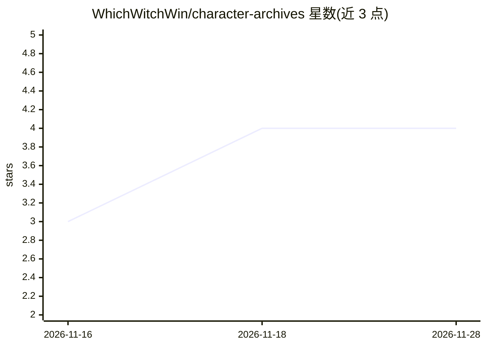

# WhichWitchWin/character-archives

⭐ 4 · JavaScript · GPL-3.0 · 推送 2026-11-22 · [GitHub](https://github.com/WhichWitchWin/character-archives) · 个人维护 · 中文 README

**DSH Tavern 插件：让 NPC 记住自己知道什么并按需注入**

面向 DSH Tavern 的第三方插件，为长线角色扮演维护人物档案：每轮正文写完后由独立模型调用整理「谁出场了、谁知道了什么」，生成前按固定规则打分、在 3000 字预算内把在场人物的相关记忆注入提示词。档案分「命题」与「指针」两层，同一事件可保存多个认知版本。提供侧栏面板增删改查、栏目与提示词自定义、导出导入，零运行时依赖，无需编译，上传 ZIP 或复制文件夹安装。

## 筛选速览

| 维度 | 判定 | 备注 |
|---|---|---|
| AI 角色 | `ai-enhanced` | 去掉 AI 部分产品仍成立 |
| 许可风险 | `viral` | GPL-3.0 |
| 部署形态 | `None` |  |
| 模型依赖 | — | README 未给出锁定关系 |
| 硬件要求 | — | 无带数字的原话,不猜 |
| 安装摩擦 | `medium` | 含编译或系统依赖之一 |
| 成熟度 | — | 结构信号不足 |

## 能力要点

- 命题+指针两层记忆，同一事件支持多版本认知
- 生成前按固定规则打分召回，3000 字预算注入
- 后台独立模型调用整理正文，不占正文上下文
- 零运行时依赖，免编译免装依赖

## 适用场景

- 长线角色扮演中让 NPC 记住旧事件与人际关系
- 区分人物「亲眼见过/听说/不信」的不同认知版本
- 控制注入记忆的字数预算，避免撑爆上下文

## 场景标签

`Agent 记忆` · 领域:Agent 开发

## 证据(README 行号)

> L8: > 给 DSH Tavern 的第三方插件。让 NPC **记得住自己知道什么**，并在写正文时把这些记忆按需递给模型。
> L131: **二、只在需要时递过去。** 每轮生成正文前，插件挑出**在场**人物的相关记忆，按 3000 字预算塞进提示词。挑谁、挑哪几条，靠固定规则打分：关于在场他人、关于当前地点、词语在正文里命中。**离场的人不递**——正文刚写过
> L193: - **零运行时依赖**：`plugin/` 里没有 `dependencies`

## 星数曲线

2026-11-16 3 → 2026-11-28 4（+1）

---
*卡片 v1 · prompt 1.4 · 生成 2026-11-21 · 置信度 high · 依据 README sha `03b7890455de` · [字段定义](../../DATASET.md)*
