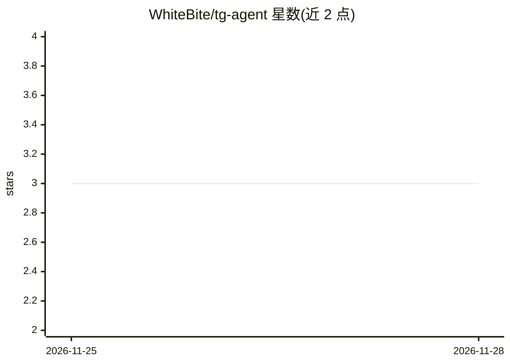

# WhiteBite/tg-agent

⭐ 3 · Python · NOASSERTION · 推送 2026-11-10 · [GitHub](https://github.com/WhiteBite/tg-agent) · 个人维护

**把 Telegram 群组索引到本地 SQLite 并以 MCP 工具供 agent 只读查询**

Read-only 数据管道：Telethon 拉取用户自己账号的 Telegram 会话，增量同步到本地 SQLite，再通过 MCP 服务器向 opencode 等客户端中的 agent 提供 19 个只读工具（watch 清单、FTS5 全文检索、实体抽取的任务/决策/期限、逾期监控、摘要与音频转录队列）。核心机制是用户先通过 Telegram 文件夹或 watch.py 标记关注的会话/话题，agent 只看到标记内容，并用别名与访问游标控制上下文。所有写入 Telegram 的能力默认关闭，需 TG_ALLOW_* 门控开启。以 Python 脚本与浏览器 UI（ui.py）形式运行。

## 筛选速览

| 维度 | 判定 | 备注 |
|---|---|---|
| AI 角色 | `ai-ecosystem` | LLM/agent 周边工具 |
| 许可风险 | `none` | NOASSERTION |
| 部署形态 | `desktop` | 安装包/桌面程序 |
| 模型依赖 | — | README 未给出锁定关系 |
| 硬件要求 | — | 无带数字的原话,不猜 |
| 安装摩擦 | `low` | 无编译、无系统依赖或容器化 |
| 成熟度 | — | 结构信号不足 |

## 能力要点

- 19 个只读 MCP 工具，覆盖 watch 清单、FTS5 检索、实体与逾期查询
- 用户通过 Telegram 文件夹或 watch.py 标记关注范围，agent 仅见标记内容
- 默认无任何写入 Telegram 的工具，写操作需 TG_ALLOW_* 门控与 confirm=True
- 浏览器工作台展示逾期/待办/决策卡片与消息证据链

## 适用场景

- 让 agent 跟踪我标记的 Telegram 群组里有什么新消息
- 从群聊历史中检索决策、任务和截止日期并监控逾期
- 对语音消息做转录并存档可检索的索引

## 场景标签

`网页抓取` · 领域:效率与自动化

## 证据(README 行号)

> L5: Read-only связка: **Telethon (твой аккаунт) → локальный SQLite → MCP-сервер → агент**.
> L13: 3. агент получает 19 read-only инструментов, которые знают твои алиасы и «что нового с прошлого раза».
> L87: Выбор пишется в ту же таблицу `watch`, которую читает MCP-сервер, — агент в

## 星数曲线

2026-11-25 3 → 2026-11-28 3（+0）

---
*卡片 v1 · prompt 1.4 · 生成 2026-11-24 · 置信度 low · 依据 README sha `3951bbe165af` · [字段定义](../../DATASET.md)*
