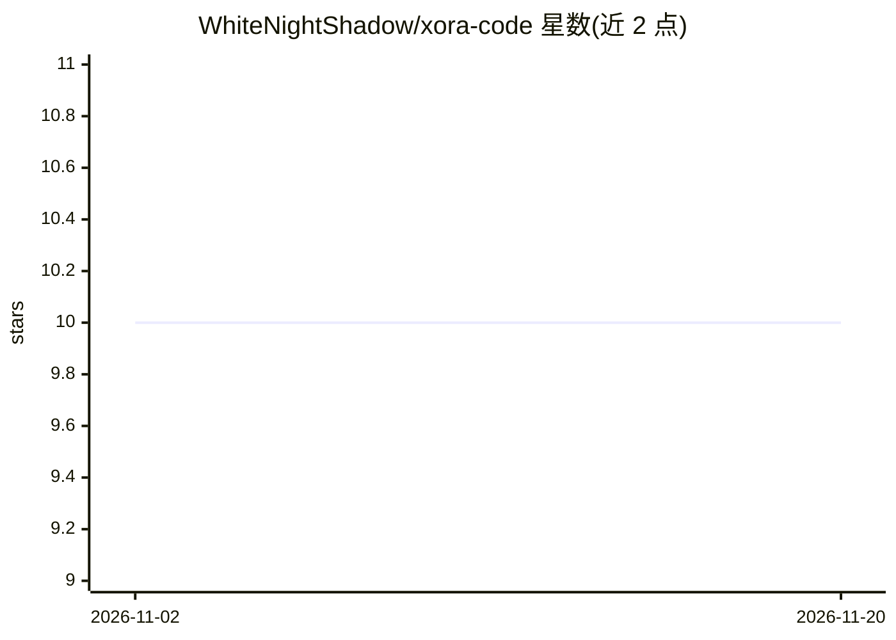

# WhiteNightShadow/xora-code

⭐ 10 · TypeScript · Apache-2.0 · 推送 2026-11-18 · [GitHub](https://github.com/WhiteNightShadow/xora-code) · [官网](https://github.com/WhiteNightShadow/xora-code) · 个人维护 · 中文 README

**三平台 agent 编程桌面：有记忆的 agent 团队与可审改动**

Xora Code 是 macOS/Windows/Linux 三平台的 agent 编程桌面，任务按"项目→对话"组织，agent 在项目目录或 git worktree 里读代码、改文件、跑命令。内置 xora 引擎，也可通过 ACP 接入 codex、claude code、gemini cli 等外部 agent；模型经 openai/anthropic 兼容接口接入，含国际、国产、本地与中转站。核心机制包括：总助手统一入口、按组织树管理的多成员团队与主管审批、长期记忆与任务状态式上下文压缩、每轮改动的 diff 审查与撤销、四档权限模式。安装包未签名公证，需手动放行；Apache-2.0 许可。

## 筛选速览

| 维度 | 判定 | 备注 |
|---|---|---|
| AI 角色 | `ai-native` | 本体是模型或模型工具 |
| 许可风险 | `permissive` | Apache-2.0 |
| 部署形态 | `desktop` | 安装包/桌面程序 |
| 模型依赖 | local-ok | 支持本地模型 |
| 硬件要求 | — | 无带数字的原话,不猜 |
| 安装摩擦 | `low` | 无编译、无系统依赖或容器化 |
| 成熟度 | — | 结构信号不足 |

## 能力要点

- 多成员 agent 团队：主管拆卡派工验收，组织树最多三层，人才市场可聘内置角色
- 任务状态式上下文整理：原话保留、早前工具输出带引用号可取回
- 每轮改动独立成卡带 diff，可整轮或按文件撤销
- 模型预设含 deepseek/kimi/glm/qwen/minimax 及本地 ollama/lm studio/llama.cpp/vllm

## 适用场景

- 在一个桌面里管理多个 agent 协作完成编码任务
- 用本地模型跑 agent 编程工作流
- 需要每轮改动可审查、可撤销的 AI 辅助开发

## 场景标签

`编码 Agent` `多智能体` `Agent 记忆` · 领域:Agent 开发

## 证据(README 行号)

> L21: Xora Code是一个三平台（macos、windows、linux）的agent编程桌面。任务按“项目→对话”组织，agent在项目目录或独立的worktree里读代码、改文件、跑命令，审批由主管替你把关；每一轮改了什么、为什
> L23: 1.0是整体重写的版本，不再基于theia和grok build。它有自己的agent引擎，也能接codex、claude code、gemini cli等外部agent；模型可以用自己的api key（国际、国产、本地、中转站）
> L130: - **内置xora引擎**：工具调用、权限、压缩、子agent都由它和host配合完成，模型通过各家的openai或anthropic兼容接口接入。

## 星数曲线

2026-11-02 10 → 2026-11-20 10（+0）

---
*卡片 v1 · prompt 1.4 · 生成 2026-11-20 · 置信度 mid · 依据 README sha `6558c8642b01` · [字段定义](../../DATASET.md)*
