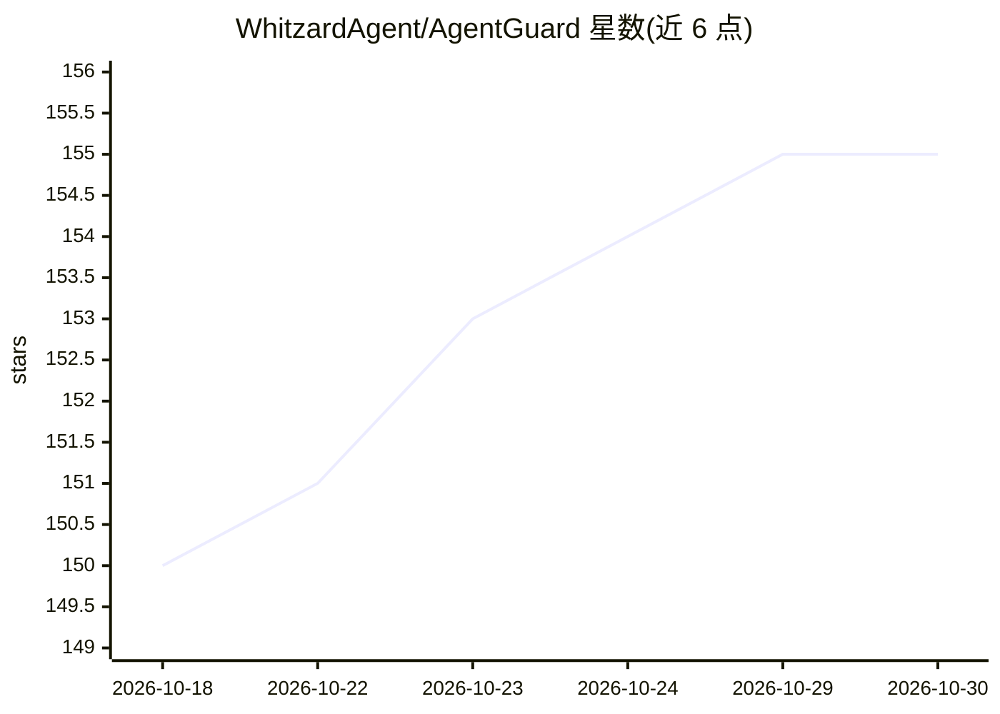

# WhitzardAgent/AgentGuard

⭐ 155 · Python · GPL-3.0 · 推送 2026-10-22 · [GitHub](https://github.com/WhitzardAgent/AgentGuard) · [官网](https://whitzard.tech/AgentGuard/) · 组织维护 · 中文 README

**面向 AI agent 的零信任安全防护层：策略化的访问控制与审计**

AgentGuard 是部署在 LLM 规划引擎与工具之间的安全防护组件，覆盖 LLM 调用前/后、工具调用前/后四个阶段的干预，可识别并拦截单次调用风险与跨步骤攻击链。通过适配器接入 LangChain、AutoGen、OpenAI Agents SDK、LangGraph、LlamaIndex、Dify、OpenClaw 等框架，无需修改框架内部逻辑；采用客户端+集中控制服务器架构，支持插件化的规则/模型策略、DSL 策略定义、可视化策略配置与审计控制台。目前拒绝通过抛异常硬阻断，软阻断为未来版本功能；项目自述仍在积极开发中可能含 bug，控制服务器部署需先安装 Docker。

## 筛选速览

| 维度 | 判定 | 备注 |
|---|---|---|
| AI 角色 | `ai-ecosystem` | LLM/agent 周边工具 |
| 许可风险 | `viral` | GPL-3.0 |
| 部署形态 | `library` | 以包/库形式分发 |
| 模型依赖 | — | README 未给出锁定关系 |
| 硬件要求 | — | 无带数字的原话,不猜 |
| 安装摩擦 | `low` | 无编译、无系统依赖或容器化 |
| 成熟度 | `idea` | |

## 能力要点

- LLM 调用前/后与工具调用前/后的四阶段拦截
- 检测跨工具攻击链（如读敏感文件后外传）
- 7 个主流 agent 框架适配器，插件化安全策略与 DSL 策略定义
- Web 控制台：可视化策略配置、运行时仪表盘与审计日志

## 适用场景

- 为企业 agent 生产部署添加访问控制与最小权限管理
- 拦截敏感数据外传、危险命令等跨步骤攻击链
- 集中管理多节点分布式 agent 的安全策略与审计

## 场景标签

`网络安全` · 领域:学习与行业

## 证据(README 行号)

> L41: AgentGuard is a zero-trust security foundation for AI agents. Compatible with existing security strategies, it iden
> L47: AgentGuard can be integrated into existing agent frameworks without modifying the underlying execution logic. Curre
> L239: - **Client**: With minimal code modifications, the AgentGuard client integrates into agent frameworks and can inte

## 星数曲线

2026-10-18 150 → 2026-10-30 155（+5）

---
*卡片 v1 · prompt 1.4 · 生成 2026-10-22 · 置信度 mid · 依据 README sha `04470300317d` · [字段定义](../../DATASET.md)*
