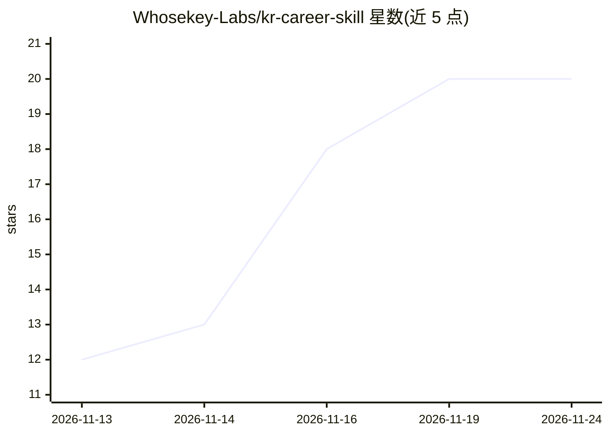

# Whosekey-Labs/kr-career-skill

⭐ 20 · Python · MIT · 推送 2026-11-12 · [GitHub](https://github.com/Whosekey-Labs/kr-career-skill) · 个人维护

**韩国求职者用的 AI 代理技能：找岗位、分析公司、写自荐书**

面向 AI 代理（Pickle、Muse、ChatGPT、Claude 等）的韩语求职技能包：以 SKILL.md 与分步指南文件组织流程——连接检查、最小档案、匹配岗位检索、公司分析、自荐书/简历草稿写入用户的 Google Docs、每日新岗位提醒。附纯标准库的 career.py 检索脚本（104 站可直接搜索、277 站平台覆盖、25 个职群指南），脚本不可用的站点由代理浏览器打开。不代替用户投递申请；MIT 许可，Python 3.9+ 可选。

## 筛选速览

| 维度 | 判定 | 备注 |
|---|---|---|
| AI 角色 | `ai-knowledge` | 知识聚合/清单类 |
| 许可风险 | `permissive` | MIT |
| 部署形态 | `None` |  |
| 模型依赖 | — | README 未给出锁定关系 |
| 硬件要求 | — | 无带数字的原话,不猜 |
| 安装摩擦 | `low` | 无编译、无系统依赖或容器化 |
| 成熟度 | — | 结构信号不足 |

## 能力要点

- 一条链接即可让支持读网页的代理安装并执行求职流程
- 覆盖 277 个招聘平台，其中 104 站支持脚本直接检索，含 25 个职群指南
- 自荐书/简历草稿可通过连接器、MCP 或 CLI 写入用户的 Google Docs
- 脚本仅用 Python 标准库，设置允许站点列表、请求间隔与次数上限

## 适用场景

- 下班后让 AI 代理按职群和条件找匹配的韩国岗位
- 根据选定岗位生成公司分析与自荐书草稿存到自己的 Google Docs
- 设置每日新岗位提醒，第二天继续追问即可衔接

## 场景标签

 · 领域:求职/职业辅助

## 证据(README 行号)

> L9:  AI 에이전트에게 링크 하나만 주면 맞춤 공고 찾기 → 회사 분석 → 자소서·이력서 초안(내 구글 문서) → 매일 새 공고 알림 까지 해 주는 AI 에이전트 스킬이에요.
> L110: |`SKILL.md`|에이전트가 처음 읽는 파일 (순서와 규칙)|
> L114: |`guides/jobs/index.md`|직군 목차 (25개 직군 파일: 세부 직무·검색 키워드·사람인 코드·전문 사이트)|

## 星数曲线

2026-11-13 12 → 2026-11-24 20（+8）

---
*卡片 v1 · prompt 1.4 · 生成 2026-11-18 · 置信度 high · 依据 README sha `5794985cd7ec` · [字段定义](../../DATASET.md)*
