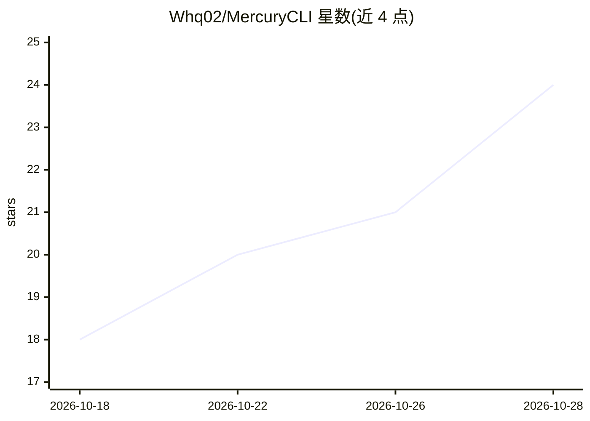

# Whq02/MercuryCLI

⭐ 26 · TypeScript · Apache-2.0 · 推送 2026-10-27 · [GitHub](https://github.com/Whq02/MercuryCLI) · [官网](https://mercury-cli.ai) · 个人维护 · 中文 README

**终端原生的 AI 编码代理环境：多会话多模型并行开发**

运行在 git 仓库内的终端 AI 编码代理环境，支持 macOS/Linux/Windows。代理可读写文件、执行 shell 命令、跑测试与调试器；用户可从 22 个模型提供商中切换模型，含 OpenAI、Anthropic、DeepSeek、OpenRouter 等，并可经 /localsetup 连接 Ollama、LM Studio、vLLM、llama.cpp 等本地运行时。支持并行会话板、跨提供商 crewmate 委派（隔离 git worktree）、混合 RAG 项目记忆（BGE+BM25）、23 语言 AST 与 DAP 调试、Whisper 离线语音输入、VS Code/Unity/Blender 桥接，并提供 TypeScript/Python SDK 与无头 JSON-RPC runner。发布包内置 Node 与 ripgrep，git 为唯一额外要求。

## 筛选速览

| 维度 | 判定 | 备注 |
|---|---|---|
| AI 角色 | `ai-ecosystem` | LLM/agent 周边工具 |
| 许可风险 | `permissive` | Apache-2.0 |
| 部署形态 | `library` | 以包/库形式分发 |
| 模型依赖 | local-ok | 支持本地模型 |
| 硬件要求 | — | 无带数字的原话,不猜 |
| 安装摩擦 | `low` | 无编译、无系统依赖或容器化 |
| 成熟度 | — | 结构信号不足 |

## 能力要点

- 22 个模型提供商同时登录并可会话中切换，支持本地权重（Ollama/LM Studio/vLLM/llama.cpp）
- 并行会话板与跨提供商 crewmate，隔离 git worktree 与会话交接笔记
- Mneme 混合 RAG 项目记忆：内置 118MB BGE 嵌入 + BM25 词排序与引用追踪
- LSP、23 语言 tree-sitter、DAP 调试器与 Whisper 离线语音输入

## 适用场景

- 在终端中用多个模型提供商并行进行 AI 辅助编码
- 跨公司/跨模型委派代理在隔离 worktree 中协作开发
- 以无头 CLI 与 SDK 将代理会话接入自动化流水线

## 场景标签

`编码 Agent` `Agent 框架` · 领域:Agent 开发

## 证据(README 行号)

> L7:  A terminal-native environment for AI coding agents, inside your own git repositories on macOS, Linux and Windows.
> L60: - **22 model providers, `/llmhost` and `/localsetup`:** keep all 22 providers signed in at once (OpenAI, Anthropic,

## 星数曲线

2026-10-18 18 → 2026-10-28 24（+6）

---
*卡片 v1 · prompt 1.4 · 生成 2026-10-28 · 置信度 mid · 依据 README sha `53820a746340` · [字段定义](../../DATASET.md)*
