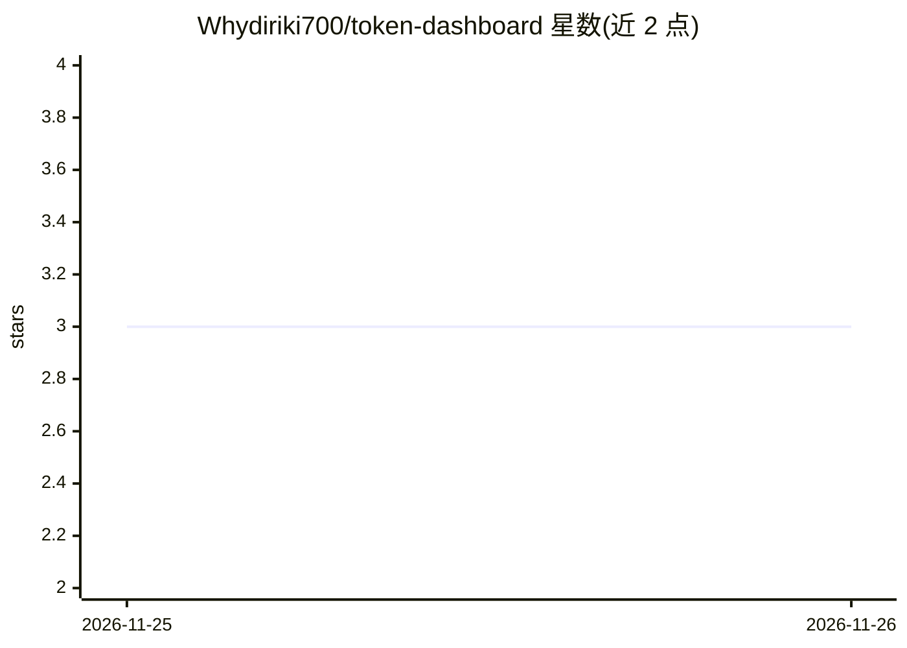

# Whydiriki700/token-dashboard

⭐ 3 · JavaScript · MIT · 推送 2026-11-21 · [GitHub](https://github.com/Whydiriki700/token-dashboard) · 个人维护

**Hermes Desktop 插件：实时显示会话 token 用量与成本**

面向 Hermes Desktop 用户的插件，将后端实时用量流渲染为成本面板：右侧窗格显示当前焦点会话的 token 数、估算成本、模型、API 调用与上下文占用，状态栏常驻成本芯片，并提供近期会话列表（每 10 秒刷新）。成本优先使用后端上报的 cost_usd，缺失时按内置价格表估算并标注。因 Hermes 不提供跨会话 token 历史，token 数据仅覆盖焦点会话。通过 hermes 插件命令安装，本地渲染、无网络请求。

## 筛选速览

| 维度 | 判定 | 备注 |
|---|---|---|
| AI 角色 | `ai-ecosystem` | LLM/agent 周边工具 |
| 许可风险 | `permissive` | MIT |
| 部署形态 | `None` |  |
| 模型依赖 | — | README 未给出锁定关系 |
| 硬件要求 | — | 无带数字的原话,不猜 |
| 安装摩擦 | `low` | 无编译、无系统依赖或容器化 |
| 成熟度 | — | 结构信号不足 |

## 能力要点

- 实时流式显示焦点会话输入/输出 token 数与估算成本
- 内置多模型每百万 token 价格表，最长键优先匹配计价
- 状态栏芯片持续显示会话成本，近期会话每 10 秒刷新
- 本地渲染，无自有网络调用与存储

## 适用场景

- 运行 Hermes 会话时实时监控 token 消耗与成本
- 按模型核对上下文占用情况
- 用估算成本做预算参考

## 场景标签

`LLM 可观测性` · 领域:评测与运维

## 证据(README 行号)

> L7: A Hermes Desktop plugin that turns the live usage stream into a cost dashboard: a right-hand pane with the focused s
> L13: * Live input and output token counts for the focused session, streamed from the backend (no polling of usage data)
> L36: hermes plugins install token-dashboard --enable

## 星数曲线

2026-11-25 3 → 2026-11-26 3（+0）

---
*卡片 v1 · prompt 1.4 · 生成 2026-11-24 · 置信度 high · 依据 README sha `d105bb4ee172` · [字段定义](../../DATASET.md)*
