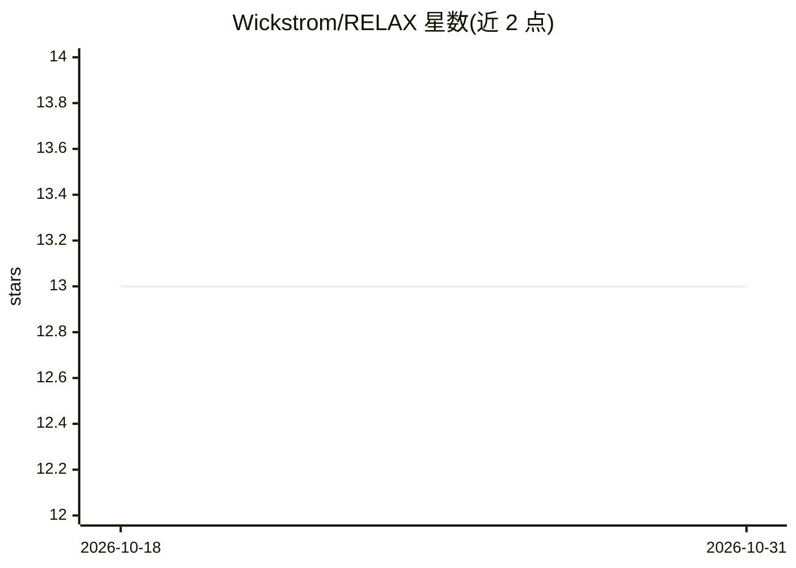

# Wickstrom/RELAX

⭐ 13 · Jupyter Notebook · MIT · 推送 2026-10-10 · [GitHub](https://github.com/Wickstrom/RELAX) · [官网](https://wickstrom.github.io/relax-project-page/) · 组织维护

**表征学习可解释性框架：用扰动掩码解释向量表征**

RELAX 是基于扰动的表征学习可解释性框架（IJCV 2023）：通过遮蔽输入局部区域并度量表征空间的变化，生成重要性归因解释。适用于输出为向量表征且无标签信息的自监督/表征学习模型。以 Python 包（pip 安装 relax-xai）提供，依赖 torch 与 torchvision；掩码生成沿用 RISE 流程，关键超参数包括 mask 数量（batch_size×num_batches，默认约 3000）、num_cells 与 probability_of_drop，可通过降低掩码数换取速度。附入门 notebook，建议在 Colab GPU 环境运行。

## 筛选速览

| 维度 | 判定 | 备注 |
|---|---|---|
| AI 角色 | `ai-native` | 本体是模型或模型工具 |
| 许可风险 | `permissive` | MIT |
| 部署形态 | `library` | 以包/库形式分发 |
| 模型依赖 | — | README 未给出锁定关系 |
| 硬件要求 | — | 无带数字的原话,不猜 |
| 安装摩擦 | `low` | 无编译、无系统依赖或容器化 |
| 成熟度 | — | 结构信号不足 |

## 能力要点

- 扰动式重要性归因：度量输入遮蔽后表征空间的变化
- 面向无标签的向量表征输出（自监督/表征学习）
- 掩码生成沿用 RISE 流程，掩码数量等超参数可调
- 附入门 notebook，可在 Google Colab（GPU）运行

## 适用场景

- 解释自监督编码器各输入区域对表征的贡献
- 分析医学图像检索等表征模型的归因
- 研究中调节掩码数量在速度与解释质量间取舍

## 场景标签

`科研工具` · 领域:学习与行业

## 证据(README 行号)

> L12: This repository contains code for RELAX, a framework for representation learning explainability. RELAX is based on 
> L14: When should you use RELAX? If your output is a vector representation and you have no label information.

## 星数曲线

2026-10-18 13 → 2026-10-31 13（+0）

---
*卡片 v1 · prompt 1.4 · 生成 2026-10-31 · 置信度 high · 依据 README sha `06e59efb8bd4` · [字段定义](../../DATASET.md)*
