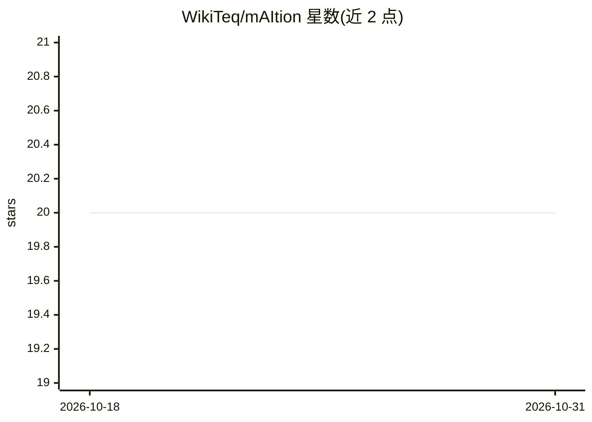

# WikiTeq/mAItion

⭐ 20 · Python · MIT · 推送 2026-10-30 · [GitHub](https://github.com/WikiTeq/mAItion) · [官网](https://maition.com) · 组织维护

**面向企业的知识聚合 RAG 对话平台，多源连接器统一问答**

mAItion 是由 WikiTeq 维护的一体化 AI 知识工具：通过 Connectors 从 S3、MediaWiki、Slack、Notion、Confluence、SharePoint、Jira、Box 等来源异步摄取数据（去重、按源配置调度），转换为 Markdown 后集中存储，用户在聊天界面中检索与对话。架构基于 Open WebUI 前端与 rag-of-all-trades RAG 服务，支持本地与远程 LLM 做嵌入与推理、MCP 服务器、代码执行、语音与图像生成、多用户权限。以 Docker Compose 部署，需 OpenRouter 或 OpenAI API key 及 S3 桶。

## 筛选速览

| 维度 | 判定 | 备注 |
|---|---|---|
| AI 角色 | `ai-native` | 本体是模型或模型工具 |
| 许可风险 | `permissive` | MIT |
| 部署形态 | `self-host` | docker 或自建部署 |
| 模型依赖 | locked-api |  |
| 硬件要求 | — | 无带数字的原话,不猜 |
| 安装摩擦 | `low` | 无编译、无系统依赖或容器化 |
| 成熟度 | — | 结构信号不足 |

## 能力要点

- 内置 11 种连接器，另可请求 100+ 额外连接器
- 支持本地与远程 LLM 的嵌入与推理
- 异步数据摄取带去重与按源调度
- 多用户细粒度分组权限，支持 MCP 服务器与代码执行

## 适用场景

- 把散落在多个外部系统中的企业知识集中到一处对话
- 为本地部署的 LLM 提供带检索的统一入口
- 按源配置调度自动同步 S3、Wiki、Jira 等数据

## 场景标签

`聊天机器人` `RAG` `知识库管理` · 领域:对话与助手

## 证据(README 行号)

> L5: mAItion is an all-in-one ready-to-use AI-powered tool that combines your existing knowledge with LLMs,
> L7: you can aggregate all your knowledge from many sources using Connectors into a central place and
> L33: * A single place to chat with your company knowledge that's scattered across many external systems

## 星数曲线

2026-10-18 20 → 2026-10-31 20（+0）

---
*卡片 v1 · prompt 1.4 · 生成 2026-10-28 · 置信度 high · 依据 README sha `53f7ba87020a` · [字段定义](../../DATASET.md)*
