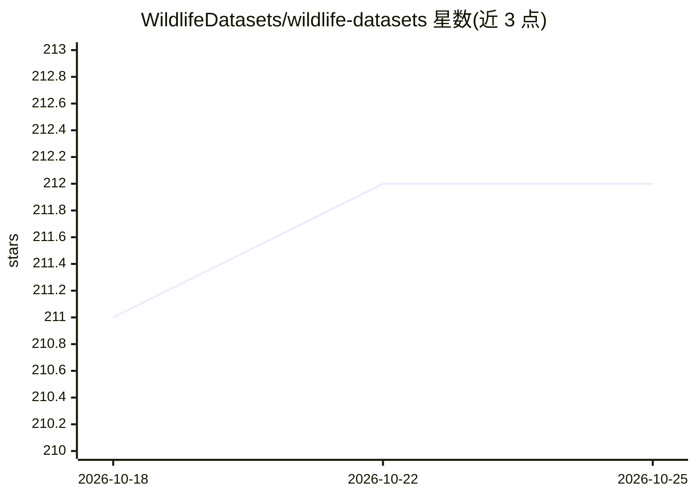

# WildlifeDatasets/wildlife-datasets

⭐ 212 · Jupyter Notebook · AGPL-3.0 · 推送 2026-10-23 · [GitHub](https://github.com/WildlifeDatasets/wildlife-datasets) · [官网](https://wildlifedatasets.github.io/wildlife-datasets/) · 组织维护

**野生动物个体重识别数据集工具包：63 个数据集聚合与处理**

面向野生动物个体重识别（Re-ID）研究的开源工具包，核心功能包括：收录 63 个公开数据集与 3 个元数据集的概览、批量下载与统一格式转换工具、标签修正，并可与 WildlifeTools 协同训练 MegaDescriptor/WildFusion 等重识别模型。支持对有标签数据库做图像分类、对无标签数据库做个体聚类。以 Python 包形式提供（pip 安装），附带 Jupyter notebook 示例。许可为 AGPL-3.0，另提供商业许可联系方式。

## 筛选速览

| 维度 | 判定 | 备注 |
|---|---|---|
| AI 角色 | `ai-knowledge` | 知识聚合/清单类 |
| 许可风险 | `dual` | AGPL-3.0 |
| 部署形态 | `library` | 以包/库形式分发 |
| 模型依赖 | — | README 未给出锁定关系 |
| 硬件要求 | — | 无带数字的原话,不猜 |
| 安装摩擦 | `low` | 无编译、无系统依赖或容器化 |
| 成熟度 | — | 结构信号不足 |

## 能力要点

- 63 个野生动物 Re-ID 公开数据集与 3 个元数据集的统一概览
- 批量下载、统一格式转换与错误标签修正工具
- 与 WildlifeTools 协同，用于训练 MegaDescriptor/WildFusion 模型
- 支持数据集划分、批量加载与评估指标等附加功能

## 适用场景

- 查找和比较野生动物个体重识别数据集
- 批量下载并将数据集转换为统一格式用于训练
- 对有标签图像库做个体分类、无标签库做个体聚类

## 场景标签

`目标检测` · 领域:感知与多模态

## 证据(README 行号)

> L9:  Pipeline for wildlife re-identification including dataset zoo, training tools and trained models. Usage includes cl
> L26: - overview of 63 publicly available wildlife re-identification datasets and 3 metadatasets.

## 星数曲线

2026-10-18 211 → 2026-10-25 212（+1）

---
*卡片 v1 · prompt 1.4 · 生成 2026-10-22 · 置信度 high · 依据 README sha `5cc60b1e5f35` · [字段定义](../../DATASET.md)*
