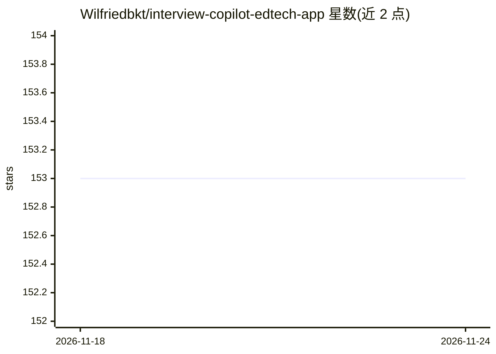

# Wilfriedbkt/interview-copilot-edtech-app

⭐ 153 · HTML · 推送 2026-11-22 · [GitHub](https://github.com/Wilfriedbkt/interview-copilot-edtech-app) · 个人维护

**面试实时辅导应用：转录问题并生成答题提示**

面向求职学习者的 EdTech 应用：实时监听面试音频并转录问题，随后生成针对当前问题的结构化答题要点、提示与框架。支持浏览器云端模式与 Electron 桌面悬浮窗两种形态，本地配置与 API 密钥保存在用户本机。后端 API 层编排音频转录与 AI 回答生成，前端为 React/Next.js/TypeScript。README 提供的系统要求为 Windows 10/11 与 PowerShell 5.1+，未给出具体安装命令；MIT 许可。

## 筛选速览

| 维度 | 判定 | 备注 |
|---|---|---|
| AI 角色 | `ai-native` | 本体是模型或模型工具 |
| 许可风险 | `none` | — |
| 部署形态 | `None` |  |
| 模型依赖 | — | README 未给出锁定关系 |
| 硬件要求 | — | 无带数字的原话,不猜 |
| 安装摩擦 | `low` | 无编译、无系统依赖或容器化 |
| 成熟度 | — | 结构信号不足 |

## 能力要点

- 实时捕获面试音频并转录问题
- 生成上下文相关的答题要点与框架
- Electron 桌面悬浮窗与浏览器两种运行形态
- 本地配置与 API 密钥保存在用户本机

## 适用场景

- 模拟面试时获得实时答题提示与结构化框架
- 真实面试练习中配合实时转录获取建议
- 软件、产品、咨询等多领域面试准备

## 场景标签

`语音识别` `AI 助手` · 领域:对话与助手

## 证据(README 行号)

> L7: Interview Copilot is an EdTech application built to close the distance between learning and landing the job you actu
> L18: 🎙️ **Live question capture:** Interview Copilot listens to interview audio and transcribes questions in real time, 
> L20: - 🧠 **Context-aware answer guidance:** Instead of canned responses, it generates structured talking points, hints, 

## 星数曲线

2026-11-18 153 → 2026-11-24 153（+0）

---
*卡片 v1 · prompt 1.4 · 生成 2026-11-18 · 置信度 mid · 依据 README sha `17384d8ca1fd` · [字段定义](../../DATASET.md)*
