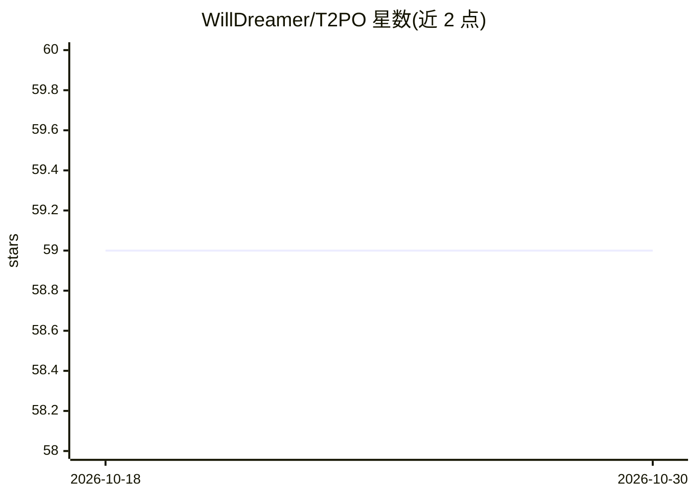

# WillDreamer/T2PO

⭐ 59 · Python · Apache-2.0 · 推送 2026-05-27 · [GitHub](https://github.com/WillDreamer/T2PO) · 个人维护 · 中文 README

**多轮 LLM Agent 强化学习训练框架，用不确定性信号控制探索**

ICML 2026 Spotlight 论文 T2PO 的开源实现：在 token 级跟踪边际不确定性并在低于阈值时干预，在 turn 级对探索进展可忽略的轮次重采样，以提升多轮 Agent RL 的训练稳定性与样本效率。基于 VeRL/PyTorch/vLLM 构建，支持具身、搜索、多模态游戏、Web 四类多轮 Agent 的训练与商业 LLM 的 Agent 评测，在 WebShop、ALFWorld、SearchQA 等基准上报告结果。通过 recipe 与 agent_system 目录支持扩展新方法与环境。面向做 Agent RL 训练的科研与工程用户。

## 筛选速览

| 维度 | 判定 | 备注 |
|---|---|---|
| AI 角色 | `ai-ecosystem` | LLM/agent 周边工具 |
| 许可风险 | `permissive` | Apache-2.0 |
| 部署形态 | `library` | 以包/库形式分发 |
| 模型依赖 | local-ok | 支持本地模型 |
| 硬件要求 | — | 无带数字的原话,不猜 |
| 安装摩擦 | `low` | 无编译、无系统依赖或容器化 |
| 成熟度 | — | 结构信号不足 |

## 能力要点

- token 级与 turn 级的双层不确定性引导探索控制
- 支持具身/搜索/多模态游戏/Web 四类多轮 Agent 训练
- 支持将商业 LLM 作为 Agent 评测
- 基于 VeRL worker 的可扩展 recipe 机制

## 适用场景

- 训练多轮 LLM Agent 的强化学习策略
- 在 WebShop/ALFWorld/SearchQA 等基准上复现实验
- 接入自定义环境扩展新的 Agent RL 方法
- 评测商业 LLM 的 Agent 能力

## 场景标签

`强化学习` `模型评测` · 领域:评测与运维

## 证据(README 行号)

> L30: ** Our method :** **T 2 PO** directly controls exploration at both the token and turn level using uncertainty signa
> L42: - ✅ Support Training Multi-turn Embody Agents
> L53: Python=3.11, VeRL=0.4.0, PyTorch=2.6.0, and vLLM=0.8.5

## 星数曲线

2026-10-18 59 → 2026-10-30 59（+0）

---
*卡片 v1 · prompt 1.4 · 生成 2026-10-24 · 置信度 mid · 依据 README sha `8eebcaffa3c6` · [字段定义](../../DATASET.md)*
