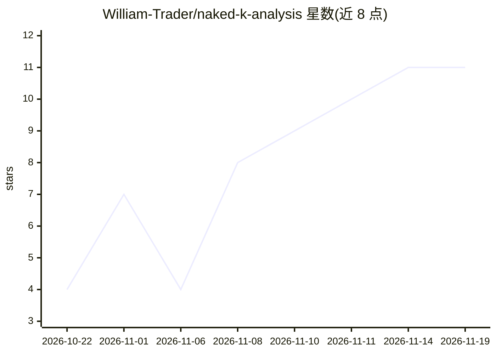

# William-Trader/naked-k-analysis

⭐ 11 · Python · NOASSERTION · 推送 2026-11-12 · [GitHub](https://github.com/William-Trader/naked-k-analysis) · 个人维护 · 中文 README

**给个人交易者的裸K价格行为分析终端，规则引擎判读+LLM 解读+QQ 群推送**

零第三方 Python 依赖的价格行为分析终端：拉取 Binance/Yahoo/新浪 K线，用确定性规则引擎计算特征、支撑阻力、形态与交易计划（armed→triggered→confirmed→managing→closed 生命周期），双周期联合研判，每次状态切换推送到唯一 QQ 群。LLM 部分可选且不参与定价，仅通过 OpenAI 兼容接口输出一句话图表解读与受限参数建议，未配置 key 时系统完整可用。含 730 天冻结快照回测与三段式 walk-forward 选参流程。仅供个人使用与团体交流，不构成投资建议。

## 筛选速览

| 维度 | 判定 | 备注 |
|---|---|---|
| AI 角色 | `ai-enhanced` | 去掉 AI 部分产品仍成立 |
| 许可风险 | `none` | NOASSERTION |
| 部署形态 | `library` | 以包/库形式分发 |
| 模型依赖 | local-ok | 支持本地模型 |
| 硬件要求 | — | 无带数字的原话,不猜 |
| 安装摩擦 | `low` | 无编译、无系统依赖或容器化 |
| 成熟度 | — | 结构信号不足 |

## 能力要点

- 确定性引擎定价，LLM 只写解读且可选，未配置 key 时系统完整可用
- 交易计划全生命周期落库：每步状态迁移写 append-only 事件、可回放、幂等推送
- 支持加密货币/大宗商品/海外指数/国内期货多市场多周期数据源
- 冻结快照 + 三段式 walk-forward + 12 组扰动压力验证的可复现回测流程

## 适用场景

- 自动监控 BTC/ETH 等 K线并向 QQ 群推送状态切换简报
- 对自有标的做双周期价格行为分析与交易计划管理
- 用冻结快照回测流程验证策略参数的样本外表现

## 场景标签

`金融量化` · 领域:学习与行业

## 证据(README 行号)

> L30: |**结论**|靠 LLM 生成|确定性引擎定价，**LLM 只写解读**；价位永远来自规则|
> L73: 支持任意 OpenAI 兼容接口（DeepSeek / OpenAI / 通义千问 / Moonshot / Ollama / vLLM）。面板 `⚙ → LLM → API Key` 可直接输入（存本机 `state/llm.k

## 星数曲线

2026-10-22 4 → 2026-11-19 11（+7）

---
*卡片 v1 · prompt 1.4 · 生成 2026-11-18 · 置信度 mid · 依据 README sha `adbc8819e2fa` · [字段定义](../../DATASET.md)*
