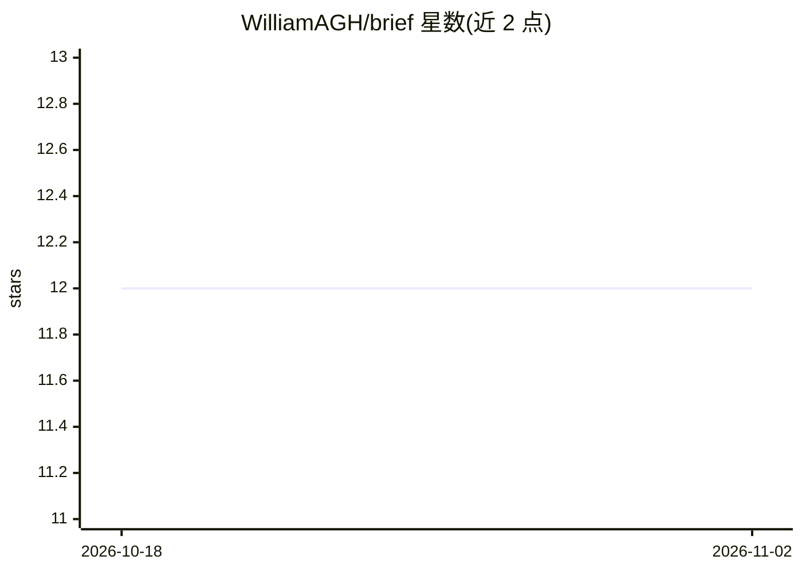

# WilliamAGH/brief

⭐ 12 · Java · 推送 2026-08-14 · [GitHub](https://github.com/WilliamAGH/brief) · [官网](https://williamcallahan.com/projects/brief) · 个人维护

**终端里的 ChatGPT 客户端：斜杠命令与工具执行**

基于 Java 的终端 ChatGPT 聊天客户端（TUI4J，Bubble Tea 的 Java 移植），面向偏好键盘操作的用户：支持斜杠命令、本地工具执行，以及 OpenAI 兼容提供商（OpenRouter、Ollama、LMStudio）。首次启动提示输入 API key 并保存到 ~/.config/brief/config。macOS 可经 Homebrew 安装，GitHub Releases 提供 ZIP 与 fat JAR，运行需 Java 25；开发用 Gradle Toolchains 与 Temurin JDK 25。

## 筛选速览

| 维度 | 判定 | 备注 |
|---|---|---|
| AI 角色 | `ai-native` | 本体是模型或模型工具 |
| 许可风险 | `none` | — |
| 部署形态 | `None` |  |
| 模型依赖 | local-ok | 支持本地模型 |
| 硬件要求 | — | 无带数字的原话,不猜 |
| 安装摩擦 | `medium` | 含编译或系统依赖之一 |
| 成熟度 | — | 结构信号不足 |

## 能力要点

- 斜杠命令与键盘优先的终端聊天界面
- 支持 OpenAI 兼容提供商（OpenRouter/Ollama/LMStudio）
- 本地工具执行与 --reasoning-effort 参数
- Homebrew 安装与 fat JAR 发行

## 适用场景

- 在终端里直接与 ChatGPT 等模型对话
- 用斜杠命令快速执行常用操作
- 通过 OpenRouter 或本地 Ollama 切换后端模型

## 场景标签

`聊天机器人` · 领域:对话与助手

## 证据(README 行号)

> L7: A terminal ChatGPT client for fast, keyboard-first chat. Includes slash commands, tool execution, and support for Op
> L26: For alternative providers (OpenRouter, Ollama, LMStudio), see the configuration guide.

## 星数曲线

2026-10-18 12 → 2026-11-02 12（+0）

---
*卡片 v1 · prompt 1.4 · 生成 2026-11-01 · 置信度 high · 依据 README sha `8639c48b133f` · [字段定义](../../DATASET.md)*
