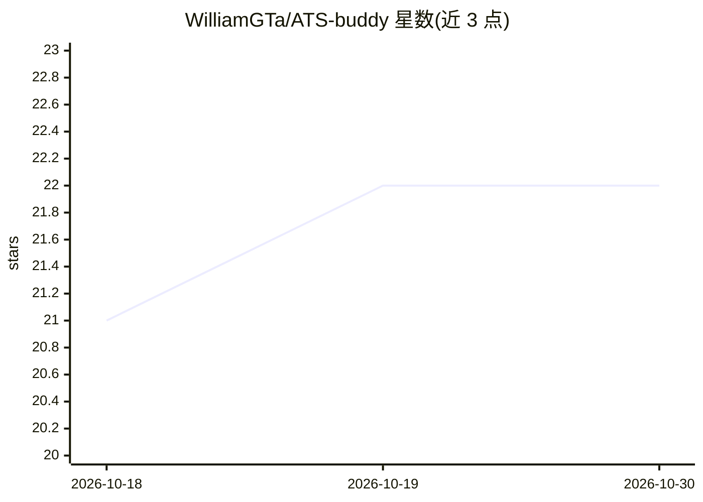

# WilliamGTa/ATS-buddy

⭐ 22 · Python · MIT · 推送 2026-04-06 · [GitHub](https://github.com/WilliamGTa/ATS-buddy) · 个人维护

**给求职者的 AI 简历匹配分析服务：评分、关键词缺口与简历优化**

部署在 AWS 上的 Serverless 应用：用户上传 PDF 简历并粘贴职位描述，经 Textract 提取文本、Comprehend 做 PII 自动脱敏后，由 Bedrock Nova Lite 输出 0-100% 兼容度评分、缺失关键词与改进建议，并可生成优化版简历及 HTML/Markdown 报告。基础设施为 Lambda + API Gateway + S3 + DynamoDB，通过 SAM CLI 部署，含内容哈希去重缓存与 24 小时自动数据清理，官方估算每千次分析成本约 $2。

## 筛选速览

| 维度 | 判定 | 备注 |
|---|---|---|
| AI 角色 | `ai-native` | 本体是模型或模型工具 |
| 许可风险 | `permissive` | MIT |
| 部署形态 | `None` |  |
| 模型依赖 | locked-api |  |
| 硬件要求 | — | 无带数字的原话,不猜 |
| 安装摩擦 | `low` | 无编译、无系统依赖或容器化 |
| 成熟度 | — | 结构信号不足 |

## 能力要点

- Bedrock Nova Lite 生成 0-100% 兼容度评分与缺失关键词分析
- Amazon Comprehend 自动 PII 脱敏，敏感数据不永久存储
- DynamoDB 内容哈希去重，上传文件与报告 24 小时自动清理
- SAM CLI 部署的 Serverless 架构（Lambda/S3/API Gateway），含 CI/CD 与监控

## 适用场景

- 投递前检查简历与目标职位的匹配度并补齐缺失关键词
- 生成含改进项的优化版简历与分析报告
- 以 Serverless 方式快速部署一套简历分析服务

## 场景标签

`AI 写作` · 领域:内容生成

## 证据(README 行号)

> L42: 3. **Analyze** - Get compatibility score, missing keywords, and suggestions
> L50: - Analyzing resume vs job description using Amazon Bedrock Nova Lite

## 星数曲线

2026-10-18 21 → 2026-10-30 22（+1）

---
*卡片 v1 · prompt 1.4 · 生成 2026-10-27 · 置信度 high · 依据 README sha `c1985f74c575` · [字段定义](../../DATASET.md)*
