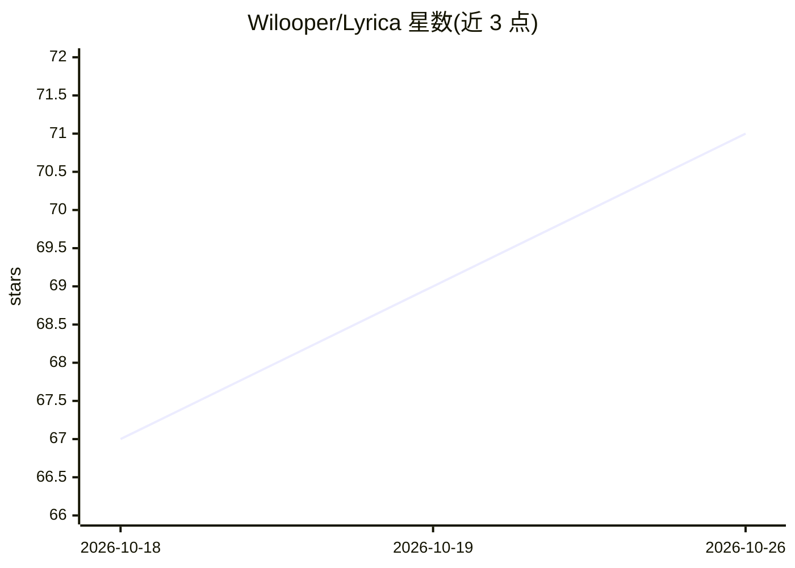

# Wilooper/Lyrica

⭐ 71 · Python · MIT · 推送 2026-10-13 · [GitHub](https://github.com/Wilooper/Lyrica) · [官网](https://test-0k.onrender.com) · 个人维护

**自托管歌词 REST API：聚合 8 源并支持 AI 翻译与多级同步**

基于 Python/Flask 的歌词聚合 API 服务：从 LRCLIB、Genius、YouTube Music、NetEase、Apple Music 等 8 个源并行抓取歌词，支持纯文本、行级 LRC、词级与音节级时间戳，并按音节→词→行→纯文本自动降级。AI 部分为通过 Groq LLM（openai/gpt-oss-120b）实现的实时歌词翻译与罗马音转写，以及情感/情绪分析。无需注册即可开箱运行，支持 Docker 部署、Gunicorn 多 worker、代理池与多级缓存。面向需要歌词数据接口的开发者。

## 筛选速览

| 维度 | 判定 | 备注 |
|---|---|---|
| AI 角色 | `ai-enhanced` | 去掉 AI 部分产品仍成立 |
| 许可风险 | `permissive` | MIT |
| 部署形态 | `self-host` | docker 或自建部署 |
| 模型依赖 | locked-api |  |
| 硬件要求 | — | 无带数字的原话,不猜 |
| 安装摩擦 | `low` | 无编译、无系统依赖或容器化 |
| 成熟度 | — | 结构信号不足 |

## 能力要点

- 8 个歌词源聚合与音节→词→行→纯文本多级同步降级
- Groq LLM 实时歌词翻译与罗马音转写（多 key 轮换）
- 情感/情绪分析、曲目元数据、Apple Music 趋势榜与 MusicBrainz 搜索建议
- L1 内存 + L2 Redis + L3 磁盘三级缓存与代理池轮换

## 适用场景

- 为卡拉OK或音乐播放器应用提供词级/音节级同步歌词接口
- 获取多语言歌词的实时翻译与罗马音转写
- 自托管歌词服务并部署到 VPS、Docker 或云平台

## 场景标签

`网页抓取` · 领域:效率与自动化

## 证据(README 行号)

> L3: > **A high-performance Python/Flask REST API for plain & timestamped lyrics, word-level sync, metadata, sentiment an
> L30: **Lyrica** aggregates song lyrics from **8 active sources** with intelligent sync-level fallback, fast parallel exe
> L35: - 🌐 **AI Translation**: Translate & romanize lyrics on-the-fly via Groq LLM (`&translate=true`).

## 星数曲线

2026-10-18 67 → 2026-10-26 71（+4）

---
*卡片 v1 · prompt 1.4 · 生成 2026-10-24 · 置信度 high · 依据 README sha `fd71d1395f68` · [字段定义](../../DATASET.md)*
