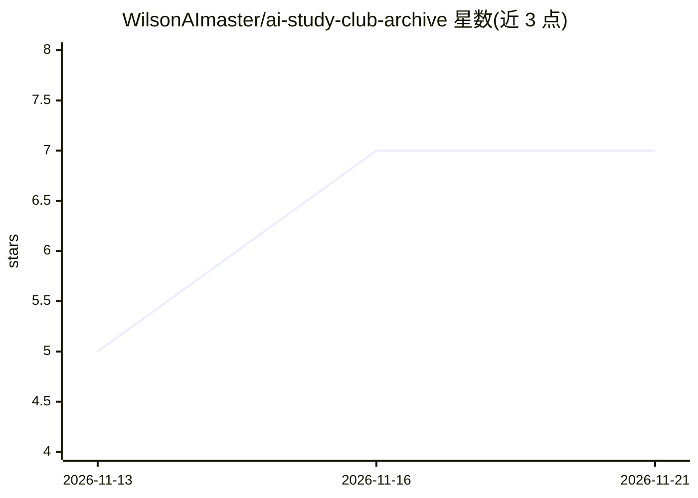

# WilsonAImaster/ai-study-club-archive

⭐ 7 · NOASSERTION · 推送 2026-11-13 · [GitHub](https://github.com/WilsonAImaster/ai-study-club-archive) · [官网](https://wilsonaimaster.github.io/ai-study-club-archive/) · 个人维护

**AI 讀書會筆記存檔：給沒到場的人補課看精華**

由 Wilson AI Lab 維護的 AI 讀書會紀錄存檔網站，將參加過的讀書會整理為精華影片、章節切分與白話重點，並依社群（如自由工坊）分區展示，附活動日期、線上觀看與下載連結。文字內容以 CC BY 4.0 授權，允許轉貼與改寫但須標註出處；錄影中講者的發言與畫面著作權仍屬講者本人。

## 筛选速览

| 维度 | 判定 | 备注 |
|---|---|---|
| AI 角色 | `ai-knowledge` | 知识聚合/清单类 |
| 许可风险 | `none` | NOASSERTION |
| 部署形态 | `None` |  |
| 模型依赖 | — | README 未给出锁定关系 |
| 硬件要求 | — | 无带数字的原话,不猜 |
| 安装摩擦 | `low` | 无编译、无系统依赖或容器化 |
| 成熟度 | — | 结构信号不足 |

## 能力要点

- 每場讀書會提供精華影片、章節與白話重點
- 紀錄依社群分區組織，附日期與影片連結
- 文字內容採 CC BY 4.0 授權，可轉貼改寫須標註出處

## 适用场景

- 沒到場參加讀書會時補看精華影片與重點
- 查找特定 AI 主題場次的章節與白話整理
- 轉貼或改寫筆記內容用於自己的學習資料

## 场景标签

`教程课程` · 领域:学习与行业

## 证据(README 行号)

> L3: 沒到場也能補課。我參加的AI讀書會，整理成精華影片、章節和白話重點，**依社群分區**。每參加一場，這裡就多一頁。
> L7: ## 紀錄列表

## 星数曲线

2026-11-13 5 → 2026-11-21 7（+2）

---
*卡片 v1 · prompt 1.4 · 生成 2026-11-20 · 置信度 high · 依据 README sha `9b9686c62900` · [字段定义](../../DATASET.md)*
