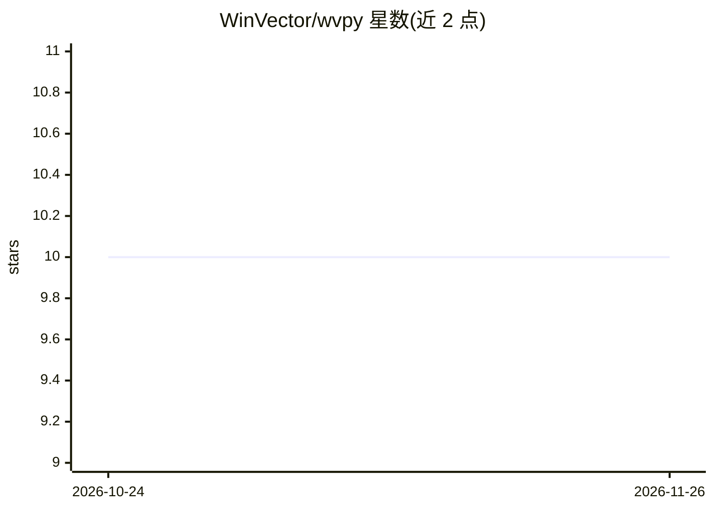

# WinVector/wvpy

⭐ 10 · HTML · NOASSERTION · 推送 2026-02-06 · [GitHub](https://github.com/WinVector/wvpy) · [官网](https://winvector.github.io/wvpy/) · 组织维护

**数据科学者的 Jupyter 笔记本与 .py 文件互转工具**

围绕 Jupyter 工作流的 Python 命令行工具：将 .ipynb 笔记本与纯 Python 文件互相转换（非 Python 块以多行字符串保留，剔除输出与元数据以便源码控制与 grep 检索），并支持以不同输入参数化运行/渲染笔记本为 HTML，可去输入块、配合 multiprocessing.Pool 并行批量生成报告。通过 pip 从 PyPI 安装，BSD 3-clause 许可，维护方为 Win Vector LLC。作者声明定位为轻量独立工具，非 jupytext/nbdev 式插件。

## 筛选速览

| 维度 | 判定 | 备注 |
|---|---|---|
| AI 角色 | `ai-ecosystem` | LLM/agent 周边工具 |
| 许可风险 | `none` | NOASSERTION |
| 部署形态 | `library` | 以包/库形式分发 |
| 模型依赖 | — | README 未给出锁定关系 |
| 硬件要求 | — | 无带数字的原话,不猜 |
| 安装摩擦 | `low` | 无编译、无系统依赖或容器化 |
| 成熟度 | — | 结构信号不足 |

## 能力要点

- .ipynb 与 .py 双向转换，保留单元边界标记
- 参数化批量运行/渲染笔记本（JTask 类，支持并行）
- HTML 渲染可选剥离输入块（--strip_input）

## 适用场景

- 只把 .py 版本提交进 Git，保持差异可读
- 同一份分析笔记本按城市/日期批量渲染为 HTML/PDF/PNG
- 工作中输出剥离代码块的进度报告

## 场景标签

 · 领域:数据科学开发工具

## 证据(README 行号)

> L7: wvpy is a very effective personal Jupyter workflow for data science development.
> L13: The two features wvpy provides are:
> L117: We also supply a simple class for holding render tasks, including inserting arbitrary initialization code for each

## 星数曲线

2026-10-24 10 → 2026-11-26 10（+0）

---
*卡片 v1 · prompt 1.4 · 生成 2026-11-20 · 置信度 mid · 依据 README sha `9d138dd11df5` · [字段定义](../../DATASET.md)*
