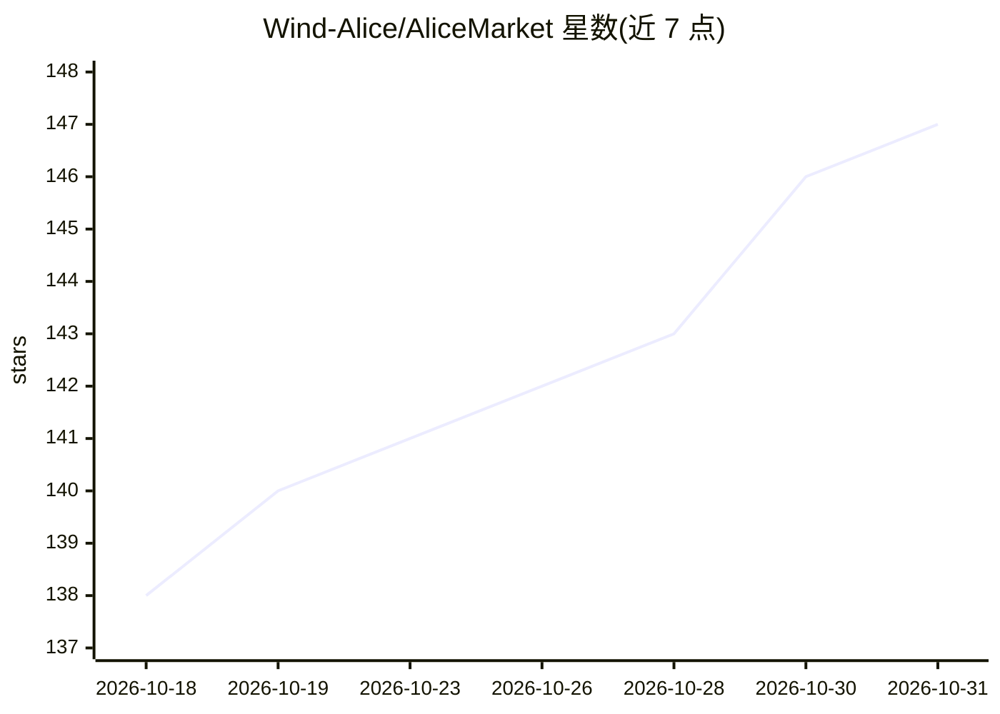

# Wind-Alice/AliceMarket

⭐ 147 · Python · 推送 2026-10-30 · [GitHub](https://github.com/Wind-Alice/AliceMarket) · [官网](https://market.windalice.com) · 组织维护 · 中文 README

**给 AI Agent 接入 Wind 金融数据与分析技能的 Skill 集合**

Wind（万得）维护的金融 Skill monorepo，收录 34 个金融 skill：通过 MCP 协议让 Claude Code / OpenClaw / Hermes 等 Agent 访问万得行情、财务、公告、研报等金融数据（wind-mcp-skill），调用 Alice 专业金融分析 Agent 完成估值建模、回测、报告生成等任务（wind-alice），另含 30 个社区分析工作流 skill 与技能发现入口。以 npx skills 命令安装，数据类 skill 需配置 Wind API Key，提供三级配置兜底。

## 筛选速览

| 维度 | 判定 | 备注 |
|---|---|---|
| AI 角色 | `ai-ecosystem` | LLM/agent 周边工具 |
| 许可风险 | `none` | — |
| 部署形态 | `library` | 以包/库形式分发 |
| 模型依赖 | — | README 未给出锁定关系 |
| 硬件要求 | — | 无带数字的原话,不猜 |
| 安装摩擦 | `low` | 无编译、无系统依赖或容器化 |
| 成熟度 | — | 结构信号不足 |

## 能力要点

- MCP 协议接入万得全市场金融数据（股票/基金/债券/宏观等）
- wind-alice 通过 A2A 协议输出多专家金融分析 Agent 能力
- 34 个 skill 覆盖估值建模、策略回测、仓位管理、盘后复盘等分析工作流
- npx skills 一条命令安装，全局或项目级可选

## 适用场景

- 让 Claude 等 Agent 直接查询 Wind 行情、财务与公告数据
- 为投资研究 Agent 添加 DCF 估值、策略回测等分析技能
- 金融问题自动推荐并安装合适 skill 的能力发现入口

## 场景标签

`金融量化` · 领域:学习与行业

## 证据(README 行号)

> L3: > **Wind 万得金融 Skill 集合（monorepo）** · 通过 MCP 协议把万得金融数据接入 Claude / OpenClaw / Hermes 等 AI Agent，并一站式收录 wind 自家数据 + 社区分
> L19: |`wind-mcp-skill`|**访问万得 Wind 金融数据**：股票（A 股/港股/美股行情与财务）、基金（行情与全维数据）、指数/板块、债券、公司公告与新闻、宏观经济指标|
> L25: |`wind-alice`|**Alice 专业金融分析 Agent 入口**：A2A 协议 + SSE 流式，跑 Alice 子 Skill（公司一页纸 / 调研问题清单 / 事实核验 / 财报点评 / 主题选股 / 基金分析 

## 星数曲线

2026-10-18 138 → 2026-10-31 147（+9）

---
*卡片 v1 · prompt 1.4 · 生成 2026-10-23 · 置信度 high · 依据 README sha `b2c50c32eae5` · [字段定义](../../DATASET.md)*
