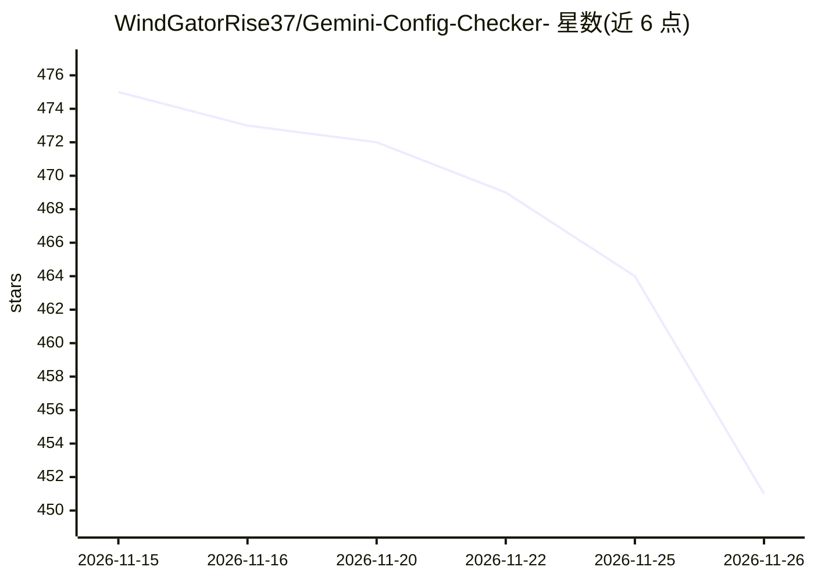

# WindGatorRise37/Gemini-Config-Checker-

⭐ 451 · Makefile · Apache-2.0 · 推送 2026-11-15 · [GitHub](https://github.com/WindGatorRise37/Gemini-Config-Checker-) · 个人维护

**测试代理配置能否进入 Google AI Studio/Gemini 的链路扫描工具**

面向需要经代理访问 Google AI Studio 与 Gemini 的用户：以登录态浏览器真实访问页面，读取 Google 的区域判定（而非普通 HTTP 连通性探测），逐条测试 vless/vmess/trojan/ss 等代理配置是否可用。Simple 模式测自有配置，Advanced 模式在可用基座配置后串接免费配置寻找其他出口；内置来自 PattN 配方的抗 DPI 配置（TLS 分片/指纹/ALPN/密码套件）与本地分片转发器。提供 Windows/macOS/Linux/Android 桌面与 APK 构建，另有 Web 服务器模式；Android 仅支持连通性模式，测试结论为采样性质。

## 筛选速览

| 维度 | 判定 | 备注 |
|---|---|---|
| AI 角色 | `ai-ecosystem` | LLM/agent 周边工具 |
| 许可风险 | `permissive` | Apache-2.0 |
| 部署形态 | `desktop` | 安装包/桌面程序 |
| 模型依赖 | — | README 未给出锁定关系 |
| 硬件要求 | — | 无带数字的原话,不猜 |
| 安装摩擦 | `medium` | 含编译或系统依赖之一 |
| 成熟度 | `idea` | |

## 能力要点

- 以登录态浏览器读取 Google 对 AI Studio/Gemini 的区域判定，每配置约 20–40 秒
- Simple/Advanced 双模式，支持免费配置列表串接与链式 Xray 配置导出
- 可编辑的抗 DPI 配置（Finalmask 分片、13 组密码套件等）与本地分片转发器
- Windows/macOS/Linux 桌面构建、Android APK 与 Web 服务器模式，发布附 SHA256SUMS

## 适用场景

- 测试我现有的代理配置里哪些真的能打开 Gemini 和 AI Studio
- 基座配置能连但被 Google 区域墙挡住时，串接免费配置寻找可用出口
- 在过滤网络内用抗 DPI 配置维持连接
- 服务器或无桌面环境下用 Web 服务器模式运行扫描

## 场景标签

`浏览器自动化` · 领域:效率与自动化

## 证据(README 行号)

> L11: Find proxy configs that actually get you into **Google AI Studio and Gemini**, by testing each one the way a person
> L50: Google decides region availability **per signed-in account, after the page has loaded**. A plain HTTP request (even
> L64: |Platform|Desktop app (native window)|Web server (UI in your browser)|Region check|

## 星数曲线

2026-11-15 475 → 2026-11-26 451（-24）

---
*卡片 v1 · prompt 1.4 · 生成 2026-11-17 · 置信度 high · 依据 README sha `846e83cebb20` · [字段定义](../../DATASET.md)*
