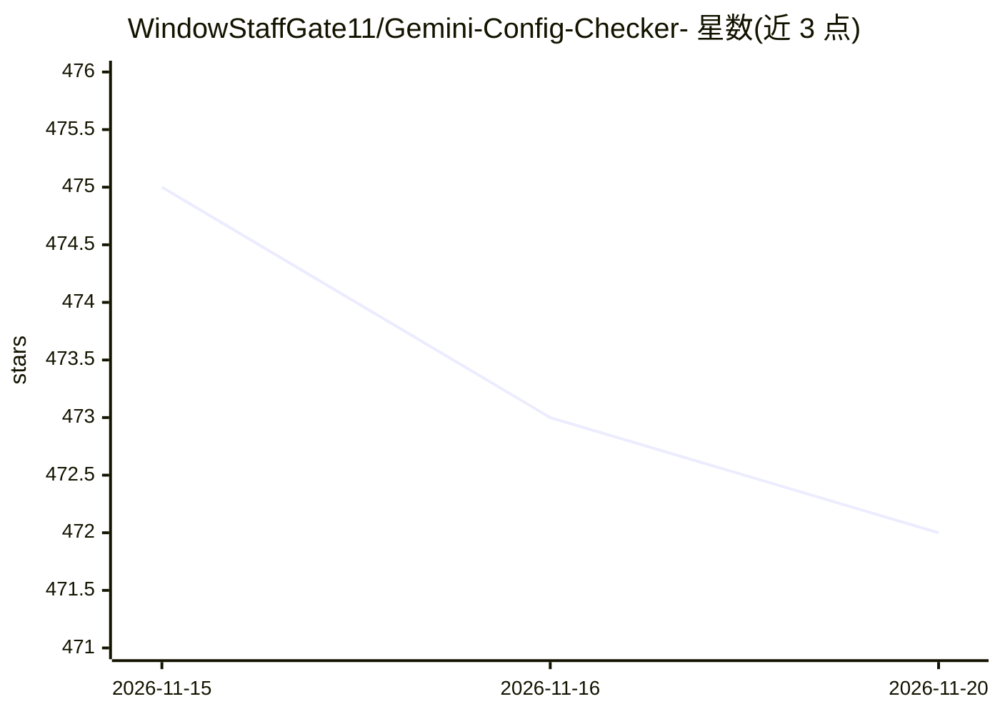

# WindowStaffGate11/Gemini-Config-Checker-

⭐ 472 · Makefile · Apache-2.0 · 推送 2026-11-15 · [GitHub](https://github.com/WindowStaffGate11/Gemini-Config-Checker-) · 个人维护

**扫描代理配置能否访问 Google AI Studio/Gemini 的桌面与移动工具**

面向需要通过代理访问 Google AI Studio 与 Gemini 的用户：批量测试 vless/vmess/trojan/ss 等配置，通过已登录浏览器读取 Google 的真实区域判定（区分连通性与区域封锁）。支持 Simple（直接测自有配置）与 Advanced（基座配置后链接入免费配置以更换出口）两种模式，内置 Xray-core 引擎与可编辑的 anti-DPI 配置（TLS ClientHello 分片）。提供 Windows/macOS/Linux 桌面版、Android APK 与本地 Web 服务端。版本 0.1.0 早期预发布，仅 Windows 经实机验证；区域检测需 Chrome/Edge/Brave，Android 仅连通性模式。

## 筛选速览

| 维度 | 判定 | 备注 |
|---|---|---|
| AI 角色 | `ai-enhanced` | 去掉 AI 部分产品仍成立 |
| 许可风险 | `permissive` | Apache-2.0 |
| 部署形态 | `desktop` | 安装包/桌面程序 |
| 模型依赖 | — | README 未给出锁定关系 |
| 硬件要求 | — | 无带数字的原话,不猜 |
| 安装摩擦 | `medium` | 含编译或系统依赖之一 |
| 成熟度 | `idea` | |

## 能力要点

- 以已登录浏览器读取 Google 对 AI Studio/Gemini 的真实区域判定
- Simple/Advanced 双模式，Advanced 支持基座→免费配置的链式扫描
- 内置 Xray-core 与可编辑 anti-DPI 配置（Finalmask/指纹/ALPN/密码套件）
- 多平台构建：桌面应用、Android APK、本地 Web 服务端（端口 8787）

## 适用场景

- 测试手头的代理配置哪些能真正打开 Gemini 与 AI Studio
- 在出口被 Google 封锁时通过配置链接入其他出口
- 在 DPI 过滤网络内验证带 anti-DPI 配置的连通性

## 场景标签

`网络安全` · 领域:学习与行业

## 证据(README 行号)

> L11: Find proxy configs that actually get you into **Google AI Studio and Gemini**, by testing each one the way a person
> L64: |Platform|Desktop app (native window)|Web server (UI in your browser)|Region check|

## 星数曲线

2026-11-15 475 → 2026-11-20 472（-3）

---
*卡片 v1 · prompt 1.4 · 生成 2026-11-17 · 置信度 high · 依据 README sha `846e83cebb20` · [字段定义](../../DATASET.md)*
