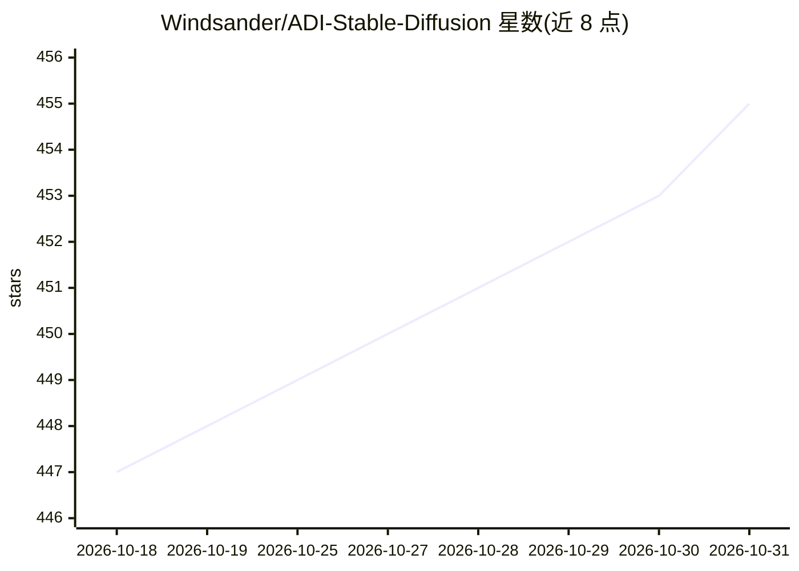

# Windsander/ADI-Stable-Diffusion

⭐ 455 · C++ · GPL-3.0 · 推送 2026-09-02 · [GitHub](https://github.com/Windsander/ADI-Stable-Diffusion) · [官网](https://adi.cyberfederal.io/) · 个人维护 · 中文 README

**C++/ONNXRuntime 的 Stable Diffusion 推理库与 CLI，跨九平台**

纯 C++17 实现的 Stable Diffusion 推理库并附带 CLI 工具，推理时零 Python 依赖，以 ONNXRuntime 为引擎、读取 .onnx 模型文件生成图像或视频。支持 SD v1.x/v2.1/SDXL/SD3.5-turbo/FLUX.1-schnell 的 txt2img 与 img2img，以及 SVD 图生视频；提供 14 种离散调度器、Karras sigmas 与 rectified-flow 家族，精度策略可按内存状况派生 fp16 副本。分发覆盖 Android×4、Linux×2、macOS arm64、Windows×2 平台制品，也支持 Homebrew 安装与本地 CMake 编译。给需要在工程部署中运行 SD 模型的开发者使用；模型需自行准备 ONNX 文件。

## 筛选速览

| 维度 | 判定 | 备注 |
|---|---|---|
| AI 角色 | `ai-native` | 本体是模型或模型工具 |
| 许可风险 | `viral` | GPL-3.0 |
| 部署形态 | `None` |  |
| 模型依赖 | — | README 未给出锁定关系 |
| 硬件要求 | — | 无带数字的原话,不猜 |
| 安装摩擦 | `high` | 编译与系统依赖俱全 |
| 成熟度 | — | 结构信号不足 |

## 能力要点

- 纯 C++17 实现，推理时零 Python 依赖，基于 ONNXRuntime
- 支持 SD v1.x～SD3.5-turbo、FLUX.1-schnell 文生图与 SVD 图生视频
- 14 种离散调度器 + Karras sigmas + rectified-flow，结果与 diffusers 核对
- 九个平台目标的自动发布链，含 Homebrew 与源码编译安装

## 适用场景

- 在没有 Python 环境的设备上本地运行 Stable Diffusion 生成图像
- 把 SD 模型以 C++ 库形式集成到工程部署
- 用 SVD 模式从单张照片生成短视频

## 场景标签

`图像生成` `推理引擎` · 领域:内容生成

## 证据(README 行号)

> L14: **Agile Diffusers Inference (ADI)** is a **C++ library** with **CLI tool**. Purpose to leverage the acceleration ca
> L17: > From SD v1.5 to SD3.5 / FLUX / SVD — pick a scheduler, point at the ONNX models, and generate.
> L21: Everything below was generated **locally by `adi` (C++ / ONNXRuntime, CPU)** — no Python, no diffusers at inference

## 星数曲线

2026-10-18 447 → 2026-10-31 455（+8）

---
*卡片 v1 · prompt 1.4 · 生成 2026-10-21 · 置信度 high · 依据 README sha `88af0fca219e` · [字段定义](../../DATASET.md)*
