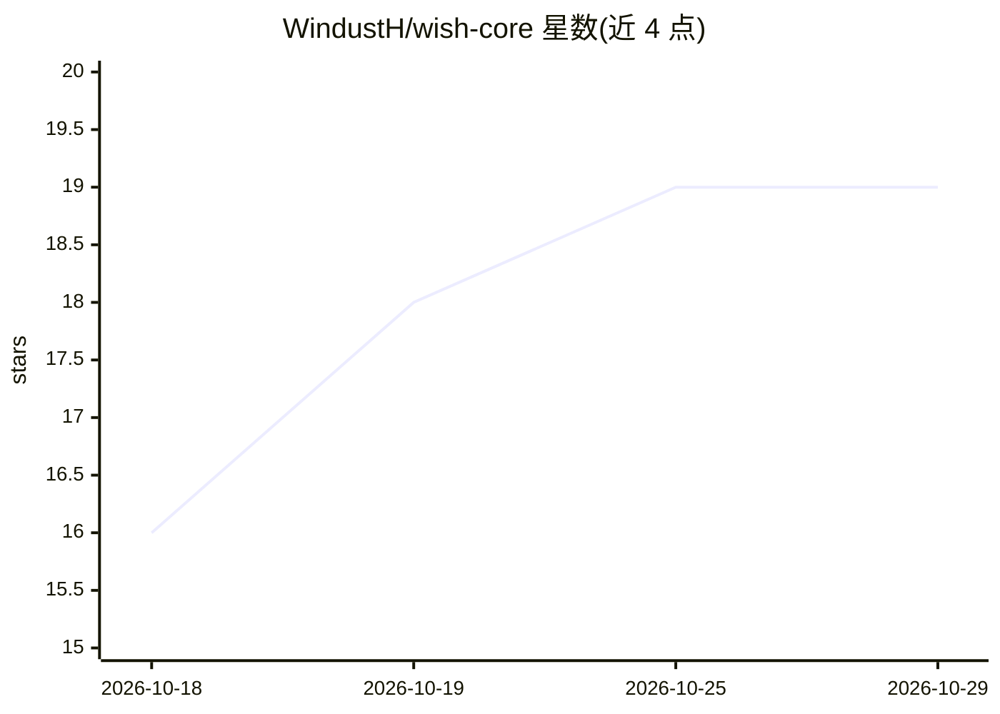

# WindustH/wish-core

⭐ 19 · Rust · MIT · 推送 2026-10-27 · [GitHub](https://github.com/WindustH/wish-core) · 个人维护 · 中文 README

**本地运行的极简 AI agent 执行框架，含 Web 应用与 HTTP API**

Wish 是一个以单个 Rust 程序交付的 AI agent harness，内嵌数据库，运行在用户自己的机器上，通过桌面/手机浏览器访问的 Web 应用或 HTTP API 使用。机制上：MCP 服务器与技能（SKILL.md）按需从 shell 查找调用，不增长模型上下文；少量通用工具（带后台任务的 shell、精确文件编辑、图片查看、联网搜索、历史搜索）加并行工具调用。预设覆盖主流模型服务商、ChatGPT 与 GitHub Copilot 订阅、Magpie 网关与本地模型。安全上默认仅监听 127.0.0.1，面向单一可信用户设计。

## 筛选速览

| 维度 | 判定 | 备注 |
|---|---|---|
| AI 角色 | `ai-ecosystem` | LLM/agent 周边工具 |
| 许可风险 | `permissive` | MIT |
| 部署形态 | `library` | 以包/库形式分发 |
| 模型依赖 | — | README 未给出锁定关系 |
| 硬件要求 | — | 无带数字的原话,不猜 |
| 安装摩擦 | `low` | 无编译、无系统依赖或容器化 |
| 成熟度 | — | 结构信号不足 |

## 能力要点

- 单 Rust 程序含内嵌数据库，无额外组件需安装
- MCP 服务器与技能按需加载，不增长上下文、不重置提示缓存
- 少量通用工具加并行工具调用（可配置串行）
- Web 应用全部功能均可经 HTTP API 使用

## 适用场景

- 在本机跑一个可通过浏览器或 API 使用的 AI agent
- 复用其他 agent 的 SKILL.md 技能与 MCP 服务器
- 以 HTTP API 集成 agent 能力到自己的流程

## 场景标签

`Agent 框架` · 领域:Agent 开发

## 证据(README 行号)

> L10: Wish is a minimal, fast AI agent that runs on your own machine. Use it from
> L22: - **Tools and skills load on demand.** MCP servers and skills (the `SKILL.md`

## 星数曲线

2026-10-18 16 → 2026-10-29 19（+3）

---
*卡片 v1 · prompt 1.4 · 生成 2026-10-29 · 置信度 high · 依据 README sha `ccb2df179d55` · [字段定义](../../DATASET.md)*
