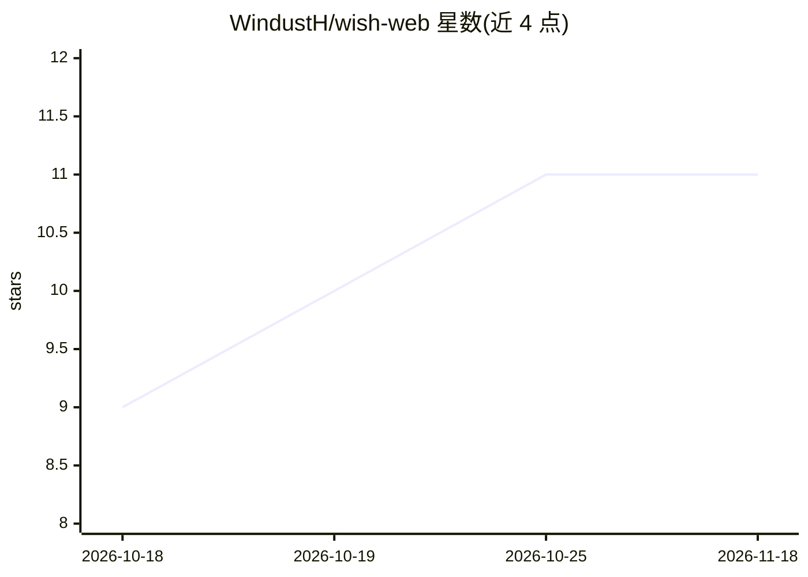

# WindustH/wish-web

⭐ 11 · Vue · MIT · 推送 2026-11-17 · [GitHub](https://github.com/WindustH/wish-web) · 个人维护 · 中文 README

**AI agent harness Wish 的跨设备 Web 界面**

本仓库是 Wish agent harness 的 Web 界面，为移动端与桌面端适配，可从任意设备访问 agent 会话。Web UI 已打包进 wish-agent npm 包与 Wish Core Releases，安装 wish-agent 并运行 wish 即在 127.0.0.1:8790 起服务端与 UI；也可针对已运行的 Wish server 单独构建托管本仓库（需 Node.js 22.19+，pnpm 构建后以 WISH_UPSTREAM 指向上游）。许可为 MIT，附第三方许可说明。

## 筛选速览

| 维度 | 判定 | 备注 |
|---|---|---|
| AI 角色 | `ai-ecosystem` | LLM/agent 周边工具 |
| 许可风险 | `permissive` | MIT |
| 部署形态 | `library` | 以包/库形式分发 |
| 模型依赖 | — | README 未给出锁定关系 |
| 硬件要求 | — | 无带数字的原话,不猜 |
| 安装摩擦 | `low` | 无编译、无系统依赖或容器化 |
| 成熟度 | — | 结构信号不足 |

## 能力要点

- 内置打包：随 wish-agent npm 包与 Wish Core Releases 分发
- 本地起服务：npm install -g wish-agent 后运行 wish 于 127.0.0.1:8790
- 可独立构建：git clone 后 pnpm 构建，通过 WISH_UPSTREAM 连接 Wish server
- 同时适配移动端与桌面端访问会话

## 适用场景

- 在手机或平板上查看与操作本地运行的 agent 会话
- 将 Wish Web 单独部署托管，对接已运行的 Wish server
- 桌面端与移动端多设备访问同一套 agent 工作流

## 场景标签

`编码 Agent` · 领域:编码与开发

## 证据(README 行号)

> L8: Wish is a clean, capable, and reliable AI agent harness. This repository holds its web interface, crafted specifical
> L16: The built web UI already comes bundled inside `wish-agent` packages and Wish Core Releases. Installing `wish-agent`
> L23: If you want to build and host `wish-web` on its own against a running Wish server (requires Node.js 22.19+):

## 星数曲线

2026-10-18 9 → 2026-11-18 11（+2）

---
*卡片 v1 · prompt 1.4 · 生成 2026-11-18 · 置信度 high · 依据 README sha `d80bab264997` · [字段定义](../../DATASET.md)*
