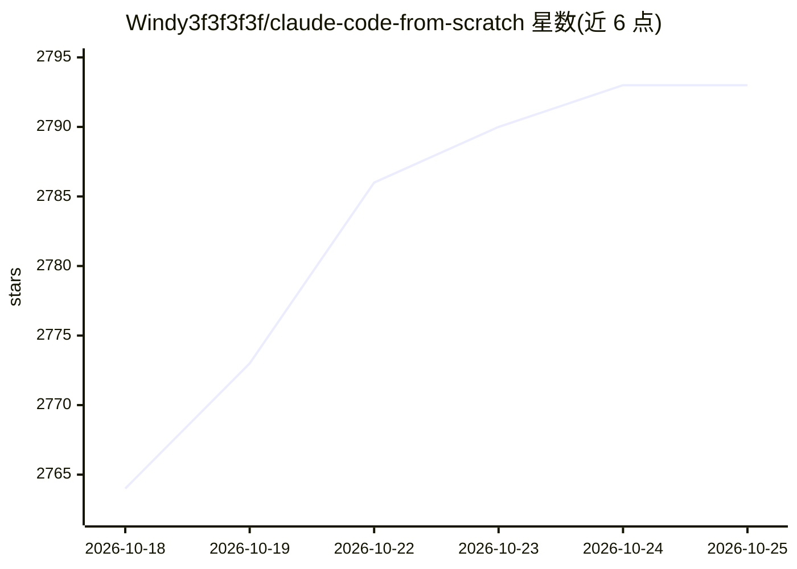

# Windy3f3f3f3f/claude-code-from-scratch

⭐ 2,794 · Python · MIT · 推送 2026-07-09 · [GitHub](https://github.com/Windy3f3f3f3f/claude-code-from-scratch) · [官网](https://windy3f3f3f3f.github.io/claude-code-from-scratch/#/) · 个人维护 · 中文 README

**从零手写 Claude Code 的分步教程（TS/Python 双版本）**

面向想理解 coding agent 内部机制的开发者教程：用约 5000 行 TypeScript 与 Python 双版本，分 13 章从零复现 Claude Code 的核心架构——Agent Loop、13 个工具、4 层上下文压缩、记忆与技能系统、多 Agent、MCP 集成，每章附与 Claude Code 的架构对照。每章代码可经 node steps/run.mjs 单独运行，默认由本地 mock 模型驱动、无需 API key；连真实模型时支持 Anthropic 与 OpenAI 兼容两种后端。项目声明基于公开可观察行为复现，不保证与 Claude Code 内部实现一致。

## 筛选速览

| 维度 | 判定 | 备注 |
|---|---|---|
| AI 角色 | `ai-knowledge` | 知识聚合/清单类 |
| 许可风险 | `permissive` | MIT |
| 部署形态 | `library` | 以包/库形式分发 |
| 模型依赖 | locked-api |  |
| 硬件要求 | — | 无带数字的原话,不猜 |
| 安装摩擦 | `low` | 无编译、无系统依赖或容器化 |
| 成熟度 | — | 结构信号不足 |

## 能力要点

- 13 章教程覆盖 Agent Loop、13 工具、4 层压缩、记忆/技能/多 Agent/MCP
- TS 与 Python 双实现，各约 5000 行
- 每章一条命令可跑，本地 mock 模型驱动无需 API key
- 支持 Anthropic 与 OpenAI 兼容双后端及自定义 base url

## 适用场景

- 想理解 coding agent 核心机制但读不动几十万行源码的开发者
- 参照教程动手实现自己的最小 coding agent
- 对比学习 Claude Code 各子系统的架构设计

## 场景标签

`教程课程` · 领域:学习与行业

## 证据(README 行号)

> L24: 本项目用 **约 5000 行代码**（TypeScript 和 Python 两个版本分别写），从零手写 Claude Code 的核心：Agent Loop、13 个工具（含并行执行 + 流式早期启动）、4 层上下文压缩、语义
> L26: 这不是 demo，是一份**分步教程**——13 章内容，跟着动手写几千行代码，从零理解一个 Coding Agent 的工作原理。而且每个代码章都能一条命令跑起来、不用 API key（见下方「每章代码都能跑」一节）。读完你就理

## 星数曲线

2026-10-18 2,764 → 2026-10-25 2,793（+29）

---
*卡片 v1 · prompt 1.4 · 生成 2026-10-21 · 置信度 high · 依据 README sha `8e9513c99220` · [字段定义](../../DATASET.md)*
