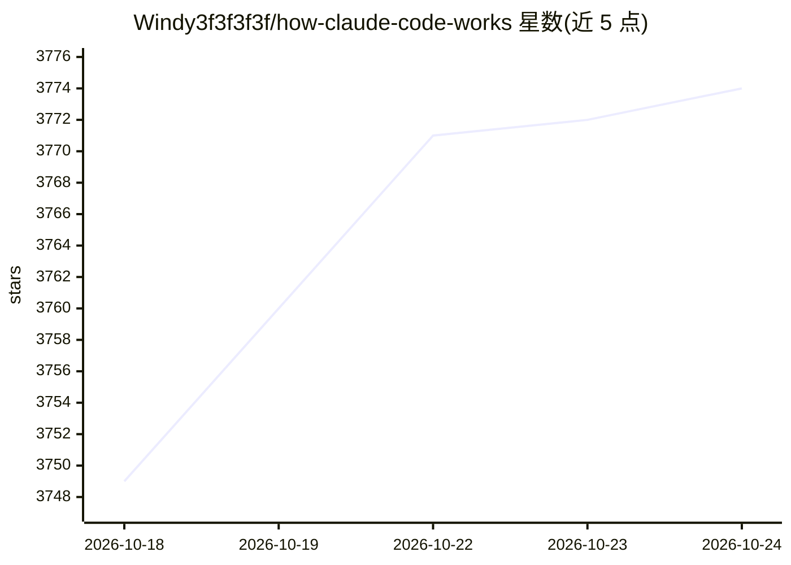

# Windy3f3f3f3f/how-claude-code-works

⭐ 3,774 · MIT · 推送 2026-08-17 · [GitHub](https://github.com/Windy3f3f3f3f/how-claude-code-works) · [官网](https://windy3f3f3f3f.github.io/how-claude-code-works/#/) · 组织维护 · 中文 README

**Claude Code 内部架构的逆向分析文档库（21 篇专题）**

对约 51.2 万行 TypeScript 的 Claude Code 源码快照做的教育性架构分析文档集，共 21 篇专题，覆盖 Agent 主循环、4 级上下文压缩、7 层权限纵深防御、工具系统、多 Agent 协作、可观测性等；快照后的新功能（/goal、/loop、Auto Mode、Dynamic Workflows 等）通过黑盒实测 + 抓包 + 开源情报方式逆向分析。面向想造 AI Agent 的开发者、Claude Code 用户与 AI 安全研究者；声明为独立研究，非 Anthropic 官方，不分发源码。配套项目 Claude Code From Scratch 提供 13 章教程。

## 筛选速览

| 维度 | 判定 | 备注 |
|---|---|---|
| AI 角色 | `ai-knowledge` | 知识聚合/清单类 |
| 许可风险 | `permissive` | MIT |
| 部署形态 | `None` |  |
| 模型依赖 | — | README 未给出锁定关系 |
| 硬件要求 | — | 无带数字的原话,不猜 |
| 安装摩擦 | `low` | 无编译、无系统依赖或容器化 |
| 成熟度 | — | 结构信号不足 |

## 能力要点

- 21 篇专题文档覆盖主循环、上下文压缩、权限防御、多 Agent 等设计
- 基于 512,000+ 行源码快照走读，快照后新功能用黑盒逆向分析
- 含 /goal、Auto Mode 分类器等完整系统提示词原文与可复现逆向方法
- 配套 Claude Code From Scratch（~4300 行，13 章教程）clean-room 实现

## 适用场景

- 开发自己的 AI Agent 前参考生产级架构设计
- 深入理解并定制 Claude Code 的 Hooks、记忆与技能系统
- 学习生产级 AI 系统的安全防御设计

## 场景标签

`教程课程` · 领域:学习与行业

## 证据(README 行号)

> L27: 我们和 Claude Code 加班从源码中提炼出 16 篇专题文档，覆盖了从核心循环到安全防护的每一个关键设计决策。不管你是想造自己的 AI Agent，还是想更深入地理解和使用 Claude Code，这里都是最短路径（应该？
> L116: |#|文档|你会了解到|

## 星数曲线

2026-10-18 3,749 → 2026-10-24 3,774（+25）

---
*卡片 v1 · prompt 1.4 · 生成 2026-10-20 · 置信度 high · 依据 README sha `4f273e36036e` · [字段定义](../../DATASET.md)*
