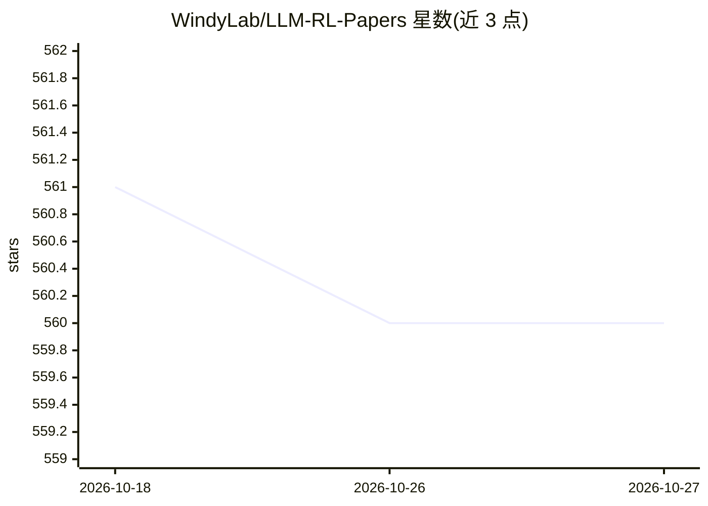

# WindyLab/LLM-RL-Papers

⭐ 560 · 推送 2025-11-17 · [GitHub](https://github.com/WindyLab/LLM-RL-Papers) · 组织维护

**追踪 LLM×强化学习交叉研究的论文清单，聚焦控制方向**

由 WindyLab 维护的 arXiv 论文跟踪清单：收录 LLM 与强化学习结合的研究，重点关注控制场景（游戏角色、机器人）。正文按方法分类整理论文（动作生成、奖励函数设计、状态表示、技能规划等十余类），并附多篇综述的概述与链接（MARL、游戏智能体、LLM-enhanced RL 分类法等）。支持通过 PR 提交新论文，无代码或安装步骤，条目为标题加 arXiv 链接形式。

## 筛选速览

| 维度 | 判定 | 备注 |
|---|---|---|
| AI 角色 | `ai-knowledge` | 知识聚合/清单类 |
| 许可风险 | `none` | — |
| 部署形态 | `None` |  |
| 模型依赖 | — | README 未给出锁定关系 |
| 硬件要求 | — | 无带数字的原话,不猜 |
| 安装摩擦 | `low` | 无编译、无系统依赖或容器化 |
| 成熟度 | — | 结构信号不足 |

## 能力要点

- 按 Action/Reward Function/State Representation 等十余个方法类别组织论文
- 收录 LLM×RL 综述并附概述（RL4LLM/LLM4RL/RL+LLM 分类法等）
- 开放 PR 收录社区推荐论文

## 适用场景

- 查找 LLM 与强化学习结合用于控制（机器人/游戏）的论文
- 了解 LLM-enhanced RL 的方法分类与综述脉络

## 场景标签

`精选清单` · 领域:学习与行业

## 证据(README 行号)

> L1: # LLM RL Papers
> L3: 1. Monitoring recent cross-research on LLM &amp; RL;
> L4: 2. Focusing on combining their capabilities for **control** (such as game characters, robotics);

## 星数曲线

2026-10-18 561 → 2026-10-27 560（-1）

---
*卡片 v1 · prompt 1.4 · 生成 2026-10-22 · 置信度 high · 依据 README sha `6611d5e959ae` · [字段定义](../../DATASET.md)*
