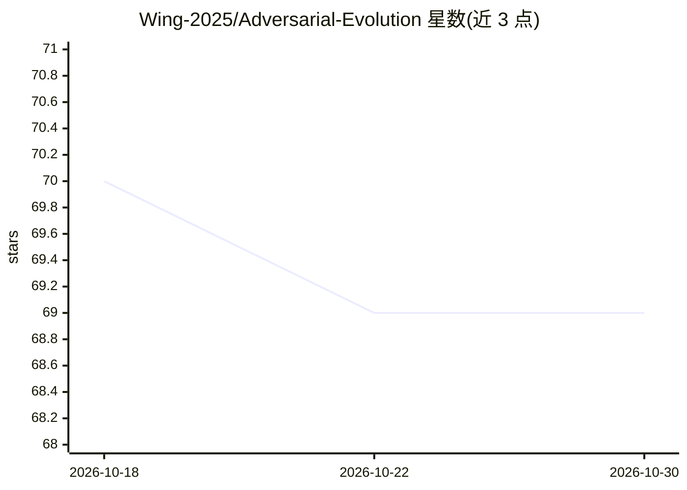

# Wing-2025/Adversarial-Evolution

⭐ 69 · Python · MIT · 推送 2025-12-24 · [GitHub](https://github.com/Wing-2025/Adversarial-Evolution) · [官网](https://www.zhihu.com/column/c_1333887646586740736) · 个人维护 · 中文 README

**演化理论系列丛书书稿仓库：生命演化与文明兴衰的统一解释**

个人作者维护的《对抗演化与合作跃升》三部曲书稿仓库：以演化论视角分析从真核生命出现、多细胞形成到人类起源、文明兴衰的底层逻辑，并延伸解释政治、宗教、法律、市场经济等社会现象。内容包含全书小节导航、三卷结构（生命演化/人类演化/生命奇迹与永生哲学）、英文翻译版、全书导读及喜马拉雅音频听书链接，并列出 115 条参考文献。仓库为纯文本内容，未提供软件安装或运行方式，主题标签含 ai 与 generative-adversarial-net 但 README 正文未涉及 AI 技术内容。

## 筛选速览

| 维度 | 判定 | 备注 |
|---|---|---|
| AI 角色 | `ai-knowledge` | 知识聚合/清单类 |
| 许可风险 | `permissive` | MIT |
| 部署形态 | `None` |  |
| 模型依赖 | — | README 未给出锁定关系 |
| 硬件要求 | — | 无带数字的原话,不猜 |
| 安装摩擦 | `low` | 无编译、无系统依赖或容器化 |
| 成熟度 | — | 结构信号不足 |

## 能力要点

- 三卷书稿：生命演化、人类演化、生命奇迹与永生哲学
- 跨维度相似性原理统一解释生命演化与社会现象
- 提供英文翻译版（更新中）与喜马拉雅音频听书
- 列出 115 条参考文献（书籍、视频、纪录片）

## 适用场景

- 阅读以演化视角解释生命史与文明兴衰的系列书稿
- 通过音频听书方式了解全书内容
- 查阅作者整理的演化论与大历史相关参考书目

## 场景标签

 · 领域:科普/思想著作

## 证据(README 行号)

> L13: 《对抗演化与合作跃升》系列丛书以科学的方法论深入地分析了几十亿年来生命演化中重要事件和关键节点的底层逻辑，并从中归纳出生命演化的普遍规律。它利用跨维度相似性原理简洁而统一地解释了从真核生命的出现、多细胞动物的形成、到人类起源的原理
> L40: # 全书三卷已完成，持续优化中！
> L42: - 卷一：生命演化的史诗：从生命到文明的底层逻辑

## 星数曲线

2026-10-18 70 → 2026-10-30 69（-1）

---
*卡片 v1 · prompt 1.4 · 生成 2026-10-24 · 置信度 high · 依据 README sha `f1b5e127eec2` · [字段定义](../../DATASET.md)*
