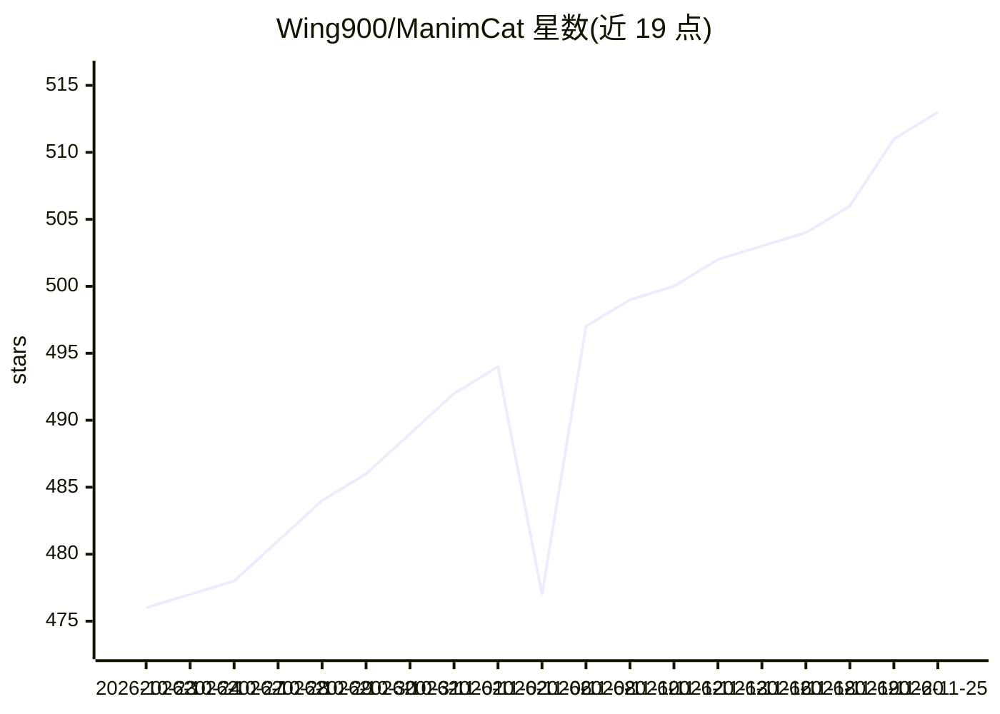

# Wing900/ManimCat

⭐ 513 · TypeScript · AGPL-3.0 · 推送 2026-11-11 · [GitHub](https://github.com/Wing900/ManimCat) · [官网](https://manimcat.5051001.xyz/) · 个人维护 · 中文 README

**面向数学教学者的自然语言生成 Manim 动画与静态图像工具**

以 Web 工作区形式提供数学可视化创作系统，包含 Workflow 与 Agent 双模式：前者自然语言直出视频/图像，后者提供 Studio 内逐场景对话与工具调用（开发中）。动画走自研 ManimGX 引擎并用 Typst 排版（无需外部 TeX），静态图走 Plot Studio/matplotlib。采用两阶段生成（概念设计→代码生成），支持规划卡编辑、自动格式修复与重渲染。本地渲染要求 Python 3.13+ 与 Linux bubblewrap 沙箱，无沙箱则服务拒绝启动。

## 筛选速览

| 维度 | 判定 | 备注 |
|---|---|---|
| AI 角色 | `ai-native` | 本体是模型或模型工具 |
| 许可风险 | `viral` | AGPL-3.0 |
| 部署形态 | `self-host` | docker 或自建部署 |
| 模型依赖 | — | README 未给出锁定关系 |
| 硬件要求 | — | 无带数字的原话,不猜 |
| 安装摩擦 | `low` | 无编译、无系统依赖或容器化 |
| 成熟度 | `idea` | |

## 能力要点

- 自然语言生成可编辑视频与静态图像，支持规划卡与两阶段生成
- ManimGX 动画引擎内置 Typst 排版，支持中文文本与数学混排，无需外部 TeX
- matplotlib 驱动的 Plot Studio 静态图形迭代编辑
- 强制 bubblewrap 渲染沙箱，无网络、无宿主权限

## 适用场景

- 为课堂讲解快速生成几何证明或概念动画
- 将例题拆解过程做成教学可视化素材
- 迭代编辑静态数学图表与教学图示

## 场景标签

`代码生成` `视频生成` · 领域:编码与开发

## 证据(README 行号)

> L28: It is designed for classroom explanation, worked-example breakdowns, and visual reasoning tasks. You can use natura
> L188: Workflow mode is the current main path: describe what you want in natural language and get a playable video or a u
> L32: - `Workflow Mode` is for direct generation and rendering when you want fast outputs

## 星数曲线

2026-10-23 476 → 2026-11-25 513（+37）

---
*卡片 v1 · prompt 1.4 · 生成 2026-11-25 · 置信度 mid · 依据 README sha `1252b8b702c7` · [字段定义](../../DATASET.md)*
