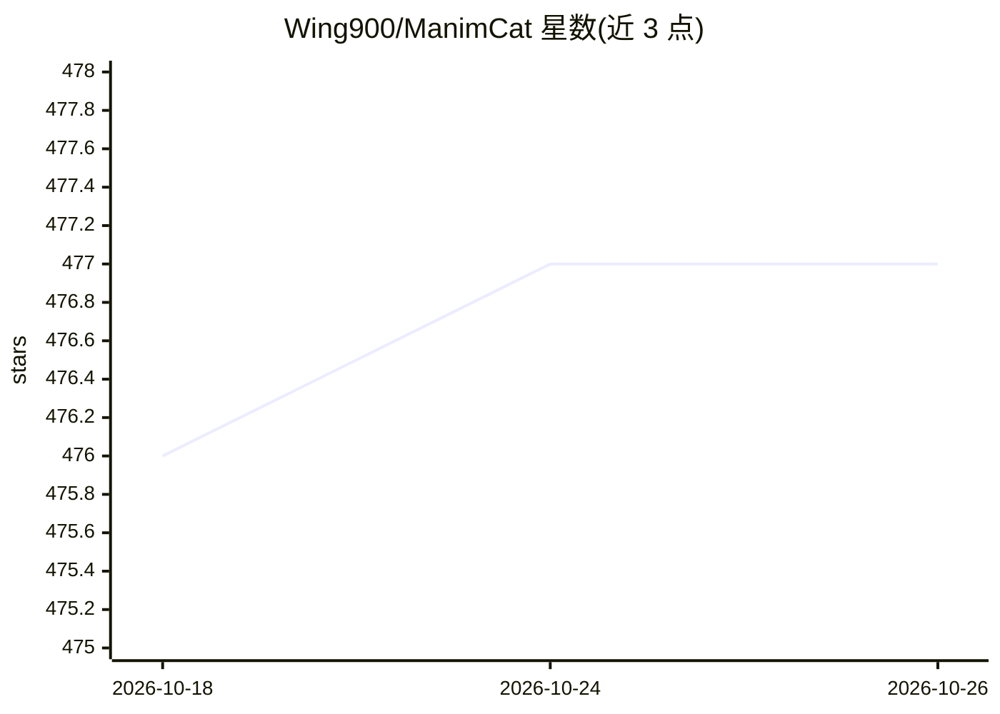

# Wing900/ManimCat

⭐ 477 · TypeScript · AGPL-3.0 · 推送 2026-10-19 · [GitHub](https://github.com/Wing900/ManimCat) · 个人维护 · 中文 README

**面向教学场景的 AI 数学动画/图表生成 Web 应用**

基于 manim-video-generator 大幅重构的 AI 辅助数学可视化创作系统：用自然语言生成、修改、重渲染数学动画（ManimGX）与静态图表（matplotlib），提供直接生成的 Workflow 模式与基于 Agent 会话的 Studio 模式，内置两阶段生成（场景设计→代码生成）与渲染失败后自动反馈重试。后端为 Express+Bull+Redis，通过 OpenAI 兼容 API 接入模型，支持 Docker 与 Hugging Face Spaces 部署；Manim Studio 路径作者自述仍处早期阶段，由独立爱好者维护。

## 筛选速览

| 维度 | 判定 | 备注 |
|---|---|---|
| AI 角色 | `ai-native` | 本体是模型或模型工具 |
| 许可风险 | `viral` | AGPL-3.0 |
| 部署形态 | `self-host` | docker 或自建部署 |
| 模型依赖 | — | README 未给出锁定关系 |
| 硬件要求 | — | 无带数字的原话,不猜 |
| 安装摩擦 | `low` | 无编译、无系统依赖或容器化 |
| 成熟度 | `idea` | |

## 能力要点

- 自然语言生成/修改/重渲染 Manim 动画与 matplotlib 静态图
- 两阶段 AI 生成：概念设计器产出场景设计，再由代码生成器写 Manim 代码
- 渲染失败自动将错误回传模型重新生成并重渲染
- Agent 模式提供 builder/designer/reviewer 角色与 SSE 实时会话更新

## 适用场景

- 教师用一句话生成数学概念讲解动画
- 制作解题步骤的可视化演示视频
- 生成静态数学图表与教学插图并迭代编辑

## 场景标签

`视频生成` · 领域:内容生成

## 证据(README 行号)

> L37: It is designed for classroom explanation, worked-example breakdowns, and visual reasoning tasks. You can use natura
> L35: Built on top of manim-video-generator, ManimCat is now a much broader AI-assisted creation system for math teaching

## 星数曲线

2026-10-18 476 → 2026-10-26 477（+1）

---
*卡片 v1 · prompt 1.4 · 生成 2026-10-21 · 置信度 mid · 依据 README sha `edd8c25c9e08` · [字段定义](../../DATASET.md)*
