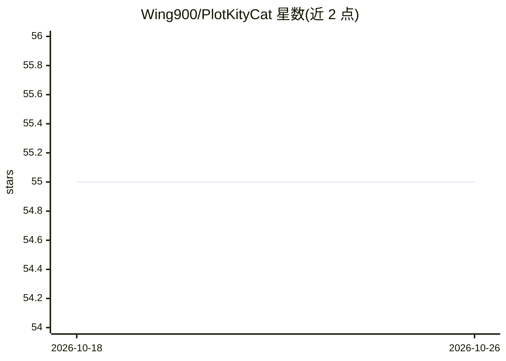

# Wing900/PlotKityCat

⭐ 55 · Go · GPL-3.0 · 推送 2026-10-13 · [GitHub](https://github.com/Wing900/PlotKityCat) · [官网](https://tour.5051001.xyz) · 个人维护 · 中文 README

**面向数学教师的 AI 可视化教学工具：自然语言生成 Matplotlib 图**

基于 Wails v2 + Vue 3 + Go 的 Windows 桌面应用，为初高中数学教学提供自然语言驱动的可视化工作流：教师描述数学概念或图像，AI 生成 Matplotlib 代码，可在应用内编辑代码、组织 Markdown/LaTeX 笔记并调整图像。支持自定义 OpenAI-compatible API（Base URL、API Key、Model）。携带独立 WinPython Runtime，支持 U 盘免安装运行；当前发布目标为 Windows AMD64。提供安装版、免安装版与新手教程，GPL-3.0 许可。

## 筛选速览

| 维度 | 判定 | 备注 |
|---|---|---|
| AI 角色 | `ai-native` | 本体是模型或模型工具 |
| 许可风险 | `viral` | GPL-3.0 |
| 部署形态 | `desktop` | 安装包/桌面程序 |
| 模型依赖 | — | README 未给出锁定关系 |
| 硬件要求 | — | 无带数字的原话,不猜 |
| 安装摩擦 | `low` | 无编译、无系统依赖或容器化 |
| 成熟度 | — | 结构信号不足 |

## 能力要点

- 自然语言生成 Matplotlib 绘图代码，支持优化与修复
- 自定义 OpenAI-compatible API（Base URL/API Key/Model）
- 场景内管理代码、Markdown/LaTeX 笔记与可视化结果
- 携带独立 WinPython Runtime，支持 U 盘免安装运行

## 适用场景

- 用自然语言快速生成数学教学图像与交互场景
- 把公式、代码、笔记和图像组织在同一工作区备课件
- U 盘携带到教室电脑免安装演示

## 场景标签

`代码生成` `知识库管理` · 领域:编码与开发

## 证据(README 行号)

> L14:  面向数学教师的 AI-native 可视化教学工具
> L39: PlotKityCat 为初高中数学教学提供自然语言驱动的可视化工作流。教师可以描述一个数学概念、图像或交互场景，由 AI 生成 Matplotlib 代码，并在应用内继续编辑代码、组织笔记、调整图像与沉淀教学素材。
> L53: - 使用自然语言生成 Matplotlib 绘图代码。

## 星数曲线

2026-10-18 55 → 2026-10-26 55（+0）

---
*卡片 v1 · prompt 1.4 · 生成 2026-10-24 · 置信度 mid · 依据 README sha `a162c3116ec9` · [字段定义](../../DATASET.md)*
