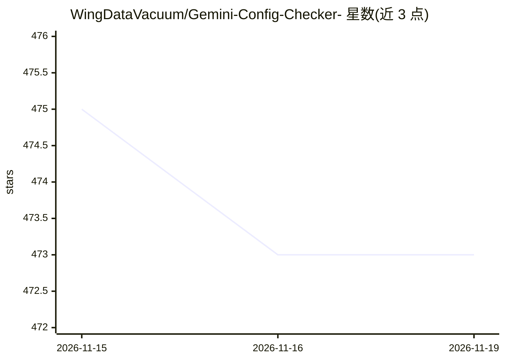

# WingDataVacuum/Gemini-Config-Checker-

⭐ 473 · Makefile · Apache-2.0 · 推送 2026-11-15 · [GitHub](https://github.com/WingDataVacuum/Gemini-Config-Checker-) · 个人维护

**代理配置检测器：核验哪些代理能真正进入 Gemini 与 AI Studio**

桌面/Web 服务工具，扫描 vless/vmess/trojan/ss 等代理配置，判断哪些能通过 Google 的地区封锁进入 AI Studio 与 Gemini。核心机制是以已登录账号的浏览器逐条实测（每个配置 20-40 秒），读取 Google 展示给登录用户的真实判定；另有仅连通性模式。支持 Simple（直测自有配置）与 Advanced（基础配置链式挂载免费配置）两种模式，内置源自 PattN 配方的抗 DPI 配置（TLS ClientHello 分片）。内嵌 Xray-core 引擎，采用 Wails 桌面壳，支持 Windows/macOS/Linux/Android。版本 0.1.0 自述为早期预发布，仅在 Windows 上完整运行过；Android 仅连通性模式，浏览器登录检查需 Chrome/Edge/Brave。

## 筛选速览

| 维度 | 判定 | 备注 |
|---|---|---|
| AI 角色 | `ai-ecosystem` | LLM/agent 周边工具 |
| 许可风险 | `permissive` | Apache-2.0 |
| 部署形态 | `desktop` | 安装包/桌面程序 |
| 模型依赖 | — | README 未给出锁定关系 |
| 硬件要求 | — | 无带数字的原话,不猜 |
| 安装摩擦 | `medium` | 含编译或系统依赖之一 |
| 成熟度 | `idea` | |

## 能力要点

- 以已登录 Google 账号的浏览器读取真实地区判定，而非 HTTP 探测
- Simple/Advanced 双模式，Advanced 支持基础配置+免费配置链式测试
- 内置可编辑的抗 DPI 配置（Finalmask 分片、cipher 套件）
- 内嵌 Xray-core 引擎，结果可导出为链接/base64/完整 Xray 配置

## 适用场景

- 测试手里一堆代理配置哪些能访问 Gemini 和 AI Studio
- Cloudflare 配置能连但出口被 Google 拦时，链式寻找可用出口
- 依赖某配置前先验证其地区可用性

## 场景标签

`网络安全` · 领域:学习与行业

## 证据(README 行号)

> L11: Find proxy configs that actually get you into **Google AI Studio and Gemini**, by testing each one the way a person
> L50: Google decides region availability **per signed-in account, after the page has loaded**. A plain HTTP request (even

## 星数曲线

2026-11-15 475 → 2026-11-19 473（-2）

---
*卡片 v1 · prompt 1.4 · 生成 2026-11-17 · 置信度 mid · 依据 README sha `846e83cebb20` · [字段定义](../../DATASET.md)*
