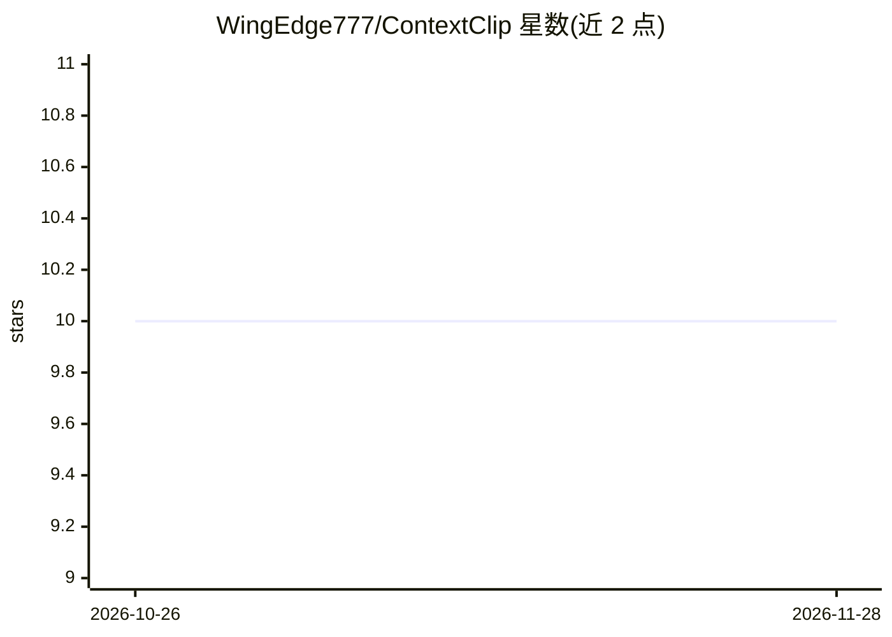

# WingEdge777/ContextClip

⭐ 10 · TypeScript · MIT · 推送 2026-06-21 · [GitHub](https://github.com/WingEdge777/ContextClip) · 个人维护 · 中文 README

**浏览器扩展：将网页精确截取为适配 LLM 的 Markdown**

Chrome 与 Firefox 浏览器扩展，从网页截取精确上下文并转为 Markdown。提供整页一键抓取与手动选取两种模式：可悬停点击选语义块，或拖拽矩形截取区域；输出含 YAML frontmatter 元数据，富媒体页面导出为 ZIP。对 arXiv、主流聊天网页、GitHub、微信公众号、知乎提供站点适配清洗。全部处理在浏览器本地完成，无服务器、无 API key，可访问需登录的页面。可通过商店、GitHub Release 或源码构建安装。

## 筛选速览

| 维度 | 判定 | 备注 |
|---|---|---|
| AI 角色 | `ai-enhanced` | 去掉 AI 部分产品仍成立 |
| 许可风险 | `permissive` | MIT |
| 部署形态 | `desktop` | 安装包/桌面程序 |
| 模型依赖 | — | README 未给出锁定关系 |
| 硬件要求 | — | 无带数字的原话,不猜 |
| 安装摩擦 | `low` | 无编译、无系统依赖或容器化 |
| 成熟度 | — | 结构信号不足 |

## 能力要点

- 悬停选块与拖拽矩形两种精确截取模式
- 输出含标题、URL、作者、截取时间等 YAML 元数据
- 对 arXiv/ChatGPT/Gemini/DeepSeek/GitHub/微信公众号/知乎提供深度清洗适配
- 全程浏览器本地运行，无服务器与 API key，支持需登录页面

## 适用场景

- 从 GitHub README 或论文中截取指定段落喂给本地 LLM
- 导出 ChatGPT/Gemini/DeepSeek 对话为结构化 Markdown 存档
- 从需登录的私有页面提取干净文本

## 场景标签

`网页抓取` · 领域:效率与自动化

## 证据(README 行号)

> L3: Browser extension (Chrome & Firefox). Clip precise web context into AI-ready Markdown.
> L6: ContextClip is a precision tool for feeding local LLMs.
> L11: Everything runs entirely in your browser.

## 星数曲线

2026-10-26 10 → 2026-11-28 10（+0）

---
*卡片 v1 · prompt 1.4 · 生成 2026-11-20 · 置信度 high · 依据 README sha `dab6ff8b3d7b` · [字段定义](../../DATASET.md)*
