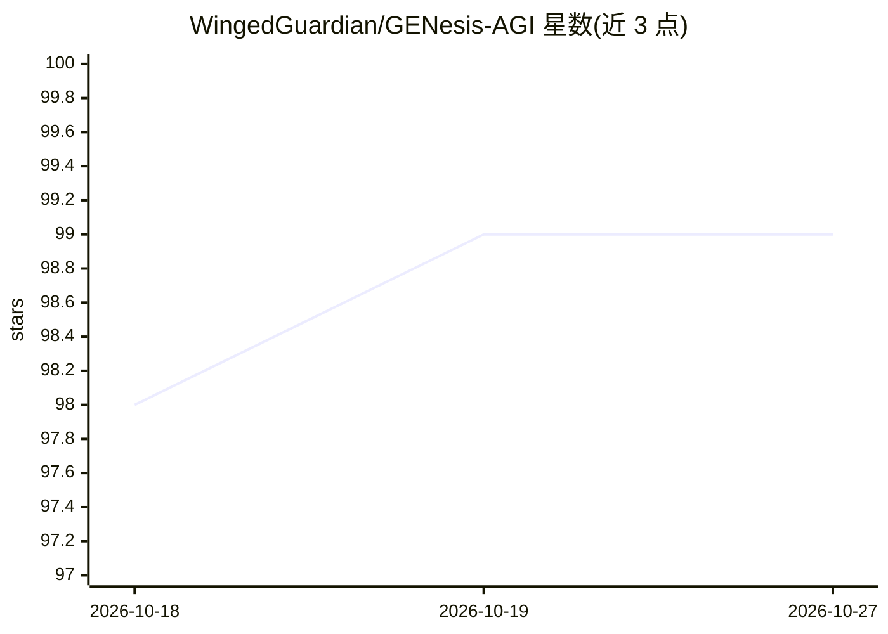

# WingedGuardian/GENesis-AGI

⭐ 99 · Python · MIT · 推送 2026-10-26 · [GitHub](https://github.com/WingedGuardian/GENesis-AGI) · [官网](https://discord.com/invite/Zkc3XMQpJX) · 个人维护

**自托管的个人自主认知体：在会话间持续思考并主动执行任务**

运行于专用 Linux 主机 Incus 容器内的认知架构系统，以 Claude Code 作为推理引擎，叠加自主认知循环（双 Ego 决策层）、四层混合检索记忆（含 Qdrant 向量库）、闭环学习与按行为类别的'挣得自治'信任机制。提供 60+ 内置工具（浏览器自动化、研究、内容创建、基础设施监控等），通过 Telegram 通道提议并执行动作，另有 Guardian/Sentinel 自愈监控。安装为单脚本全自动搭建；需 Claude 账号及至少一个 LLM provider key，不支持离线。

## 筛选速览

| 维度 | 判定 | 备注 |
|---|---|---|
| AI 角色 | `ai-native` | 本体是模型或模型工具 |
| 许可风险 | `permissive` | MIT |
| 部署形态 | `None` |  |
| 模型依赖 | local-ok | 支持本地模型 |
| 硬件要求 | — | 无带数字的原话,不猜 |
| 安装摩擦 | `low` | 无编译、无系统依赖或容器化 |
| 成熟度 | — | 结构信号不足 |

## 能力要点

- 双 Ego 自主决策层（User Ego 跑 Opus、Genesis Ego 跑 Sonnet），主动提议并派发 Claude Code 会话执行
- 四层记忆架构：L1 常驻知识、L2 主动回忆、L3 深度搜索、L4 知识管道，混合 FTS5+Qdrant 检索
- 60+ 内置工具与 4 个 MCP 服务器，每会话自动激活
- Guardian+Sentinel 双系统互相监控的自愈基础设施

## 适用场景

- 让系统在会话之外自主研究、审计记忆并跟进我的目标
- 通过 Telegram 接收主动消息、批准动作并语音交互
- 在一台专用 Linux 机器上长期运行一个积累个人上下文的智能体

## 场景标签

`AI 助手` `Agent 记忆` · 领域:Agent 开发

## 证据(README 行号)

> L34: - **Autonomous cognitive cycle** — a dual-ego architecture that wakes up, assesses the situation, proposes actions,
> L53: It uses Claude Code as its reasoning engine. Genesis is what it's been missing: the mind that remembers, reflects, 

## 星数曲线

2026-10-18 98 → 2026-10-27 99（+1）

---
*卡片 v1 · prompt 1.4 · 生成 2026-10-23 · 置信度 high · 依据 README sha `fcaf13ca228a` · [字段定义](../../DATASET.md)*
