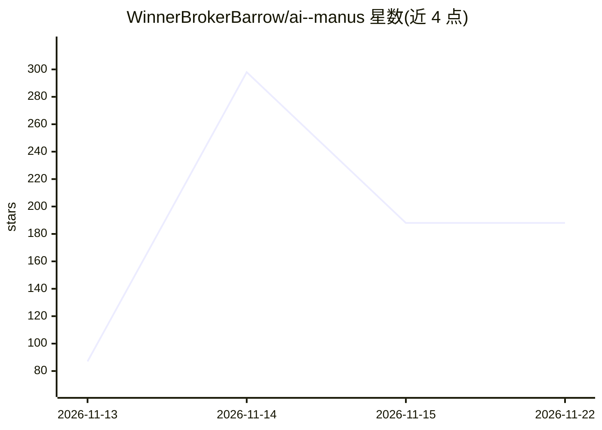

# WinnerBrokerBarrow/ai--manus

⭐ 188 · Apache-2.0 · 推送 2026-11-15 · [GitHub](https://github.com/WinnerBrokerBarrow/ai--manus) · 个人维护

**自主 AI Agent：代用户执行代码与控制浏览器完成任务**

面向个人用户（学生、远程工作者、轻办公场景）的自主 AI Agent 应用：用户以自然语言下达任务，Agent 自行编写并执行脚本、控制浏览器导航网页/填表/收集信息，并可在代码与浏览器操作间衔接完成多步任务，工具运行于沙箱环境。README 提供最低/推荐硬件兼容表（双核 CPU、4 GB 内存起），但未给出具体安装命令、源码结构或所依赖的模型接入方式，安装途径仅见 'Download Manus' 与优惠码 'PROMO2026'，可验证的技术细节有限。

## 筛选速览

| 维度 | 判定 | 备注 |
|---|---|---|
| AI 角色 | `ai-native` | 本体是模型或模型工具 |
| 许可风险 | `permissive` | Apache-2.0 |
| 部署形态 | `None` |  |
| 模型依赖 | — | README 未给出锁定关系 |
| 硬件要求 | — | 无带数字的原话,不猜 |
| 安装摩擦 | `low` | 无编译、无系统依赖或容器化 |
| 成熟度 | — | 结构信号不足 |

## 能力要点

- Agent 自主编写并执行代码完成任务
- 浏览器控制：导航网页、填表、抓取信息
- 代码执行与浏览器操作可在同一任务流中衔接
- 在沙箱环境中运行各类工具与操作

## 适用场景

- 让 Agent 代我跑小脚本、做快速计算，不用自己搭环境
- 自动浏览多个网页收集资料并整理
- 处理日常重复性小任务，如检查页面更新、整理文件

## 场景标签

`浏览器自动化` · 领域:效率与自动化

## 证据(README 行号)

> L10: - **Autonomous Code Execution:** Manus AI agent runs code on its own to complete tasks, so you can focus on decisio
> L18: Manus is an autonomous AI agent designed to run code and control a browser on your behalf. Instead of acting like a
> L22: Manus is not a heavy studio suite or a complex enterprise platform. It is a focused helper built for home, study, a

## 星数曲线

2026-11-13 87 → 2026-11-22 188（+101）

---
*卡片 v1 · prompt 1.4 · 生成 2026-11-17 · 置信度 mid · 依据 README sha `fbfd5e977bf4` · [字段定义](../../DATASET.md)*
