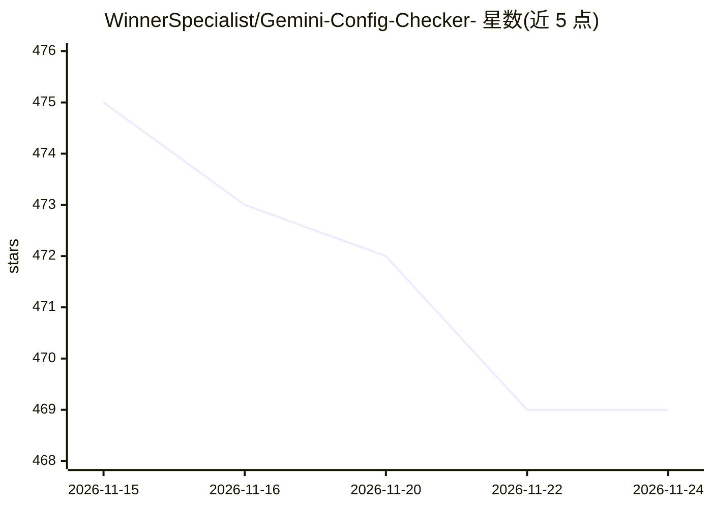

# WinnerSpecialist/Gemini-Config-Checker-

⭐ 469 · Makefile · Apache-2.0 · 推送 2026-11-15 · [GitHub](https://github.com/WinnerSpecialist/Gemini-Config-Checker-) · 个人维护

**扫描代理配置能否访问 Google AI Studio 与 Gemini 的桌面工具**

面向需要通过代理访问 Google AI Studio/Gemini 的用户：逐条测试 vless/vmess/trojan/ss 等代理配置，用独立浏览器配置文件中登录的 Google 账号读取 Google 的实际区域判定（每条约 20-40 秒），或仅做连通性测试。提供 Simple/Advanced 两模式，Advanced 可将免费配置链在可用基础配置之后换取不同出口。内置 Xray-core 引擎与基于 PattN 配方的抗 DPI 分片转发器（可调 Finalmask/ALPN/加密套件）。以 Wails 原生桌面应用（Windows/macOS/Linux/Android APK）和 Web 服务器两种构建发布。当前为 0.1.0 早期预发布版，仅在 Windows 上完整验证过，其他平台构建未经真机测试。

## 筛选速览

| 维度 | 判定 | 备注 |
|---|---|---|
| AI 角色 | `ai-enhanced` | 去掉 AI 部分产品仍成立 |
| 许可风险 | `permissive` | Apache-2.0 |
| 部署形态 | `desktop` | 安装包/桌面程序 |
| 模型依赖 | — | README 未给出锁定关系 |
| 硬件要求 | — | 无带数字的原话,不猜 |
| 安装摩擦 | `medium` | 含编译或系统依赖之一 |
| 成熟度 | `idea` | |

## 能力要点

- 用登录态浏览器读取 Google 对 AI Studio/Gemini 的真实区域判定
- Simple/Advanced 双模式：Advanced 支持免费配置链在基础配置后作出口
- 内置 Xray-core 与可编辑的抗 DPI 分片配置（Finalmask/指纹/ALPN/加密套件）
- Windows/macOS/Linux/Android 多平台原生构建与 Web 服务器模式

## 适用场景

- 测试手头一批代理配置里哪些真正能进入 AI Studio 和 Gemini
- 基础配置能连但被 Google 屏蔽出口时，链上免费配置换出口
- 在过滤网络中带抗 DPI 配置扫描可用代理

## 场景标签

 · 领域:网络工具/代理配置检测

## 证据(README 行号)

> L11: Find proxy configs that actually get you into **Google AI Studio and Gemini**, by testing each one the way a person
> L50: Google decides region availability **per signed-in account, after the page has loaded**. A plain HTTP request (even
> L113: The region check opens AI Studio and Gemini as *you*. Click **Sign in with Google** once:

## 星数曲线

2026-11-15 475 → 2026-11-24 469（-6）

---
*卡片 v1 · prompt 1.4 · 生成 2026-11-17 · 置信度 high · 依据 README sha `846e83cebb20` · [字段定义](../../DATASET.md)*
