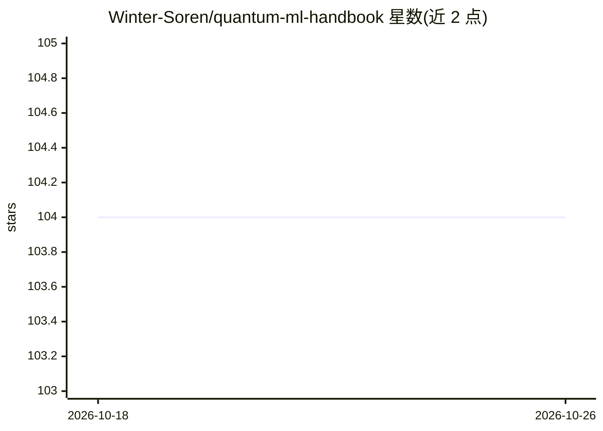

# Winter-Soren/quantum-ml-handbook

⭐ 104 · TypeScript · NOASSERTION · 推送 2026-03-12 · [GitHub](https://github.com/Winter-Soren/quantum-ml-handbook) · [官网](https://quantummlhandbook.vercel.app/) · 个人维护

**量子机器学习（QML）入门到进阶的文档手册**

面向量子计算与机器学习交叉领域初学者和实践者的文档仓库，以网站形式组织内容：Basics 部分覆盖量子计算与量子力学基础，Gates and Circuits 部分讲解量子门与电路，并规划 QML 算法、量子神经网络（QNN 各组件、量子卷积/生成/强化学习等）章节。README 以任务清单跟踪写作进度，量子电路、QML 算法等部分章节尚未完成。本地运行依赖 Node LTS，通过 npm install 与 npm start 启动本地服务器查看。

## 筛选速览

| 维度 | 判定 | 备注 |
|---|---|---|
| AI 角色 | `ai-knowledge` | 知识聚合/清单类 |
| 许可风险 | `none` | NOASSERTION |
| 部署形态 | `library` | 以包/库形式分发 |
| 模型依赖 | — | README 未给出锁定关系 |
| 硬件要求 | — | 无带数字的原话,不猜 |
| 安装摩擦 | `low` | 无编译、无系统依赖或容器化 |
| 成熟度 | — | 结构信号不足 |

## 能力要点

- 从量子力学基础、量子门到量子算法（QFT/QPE/Grover）的结构化学习路径
- 内容按 1, 2, 3 顺序标注，指示学习次序
- 规划量子神经网络与量子机器学习算法章节（部分完成）
- 提供本地文档服务器（npm start，localhost:3000）

## 适用场景

- 系统学习量子计算与量子门/电路基础
- 按既定顺序自学 QML 前置知识
- 查阅 QFT、相位估计等量子算法的电路讲解

## 场景标签

`教程课程` · 领域:学习与行业

## 证据(README 行号)

> L3: This repository contains comprehensive documentation on Quantum Machine Learning (QML), aimed at beginners and pract
> L15: - **Basics**: This section contains the basics of quantum computing and quantum mechanics. It is aimed at beginners

## 星数曲线

2026-10-18 104 → 2026-10-26 104（+0）

---
*卡片 v1 · prompt 1.4 · 生成 2026-10-23 · 置信度 high · 依据 README sha `5911bb59a651` · [字段定义](../../DATASET.md)*
