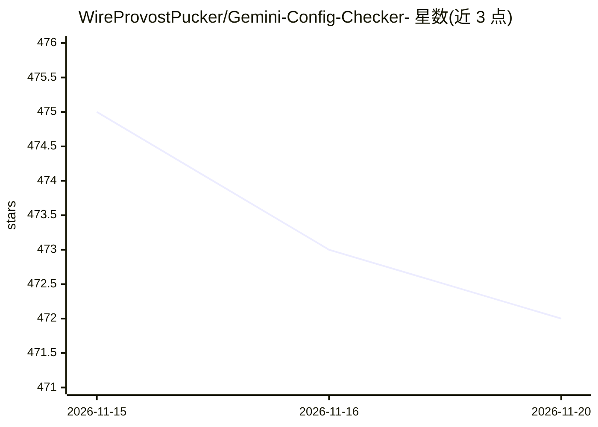

# WireProvostPucker/Gemini-Config-Checker-

⭐ 472 · Makefile · Apache-2.0 · 推送 2026-11-15 · [GitHub](https://github.com/WireProvostPucker/Gemini-Config-Checker-) · 个人维护

**扫描代理配置能否进入 Google AI Studio 与 Gemini 的检测工具**

面向受区域限制网络用户的代理配置检测器：测试 vless/vmess/trojan/ss 等配置能否真正访问 Google AI Studio 与 Gemini。核心机制是以登录 Google 账号的浏览器逐个实测每个出口的可用性，而非普通连通性探测；Advanced 模式支持在基础配置后串联免费配置以更换出口。内置反 DPI 配置（TLS ClientHello 分片）与本地 Xray 引擎，可导出链式配置。提供 Windows/macOS/Linux 桌面版、Android APK 与 Web 服务端形态；README 自述为 0.1.0 早期预发布，仅 Windows 经过端到端验证。

## 筛选速览

| 维度 | 判定 | 备注 |
|---|---|---|
| AI 角色 | `ai-ecosystem` | LLM/agent 周边工具 |
| 许可风险 | `permissive` | Apache-2.0 |
| 部署形态 | `desktop` | 安装包/桌面程序 |
| 模型依赖 | — | README 未给出锁定关系 |
| 硬件要求 | — | 无带数字的原话,不猜 |
| 安装摩擦 | `medium` | 含编译或系统依赖之一 |
| 成熟度 | `idea` | |

## 能力要点

- 以已登录浏览器的真实区域判定替代 HTTP 连通性探测（20-40 秒/配置）
- Simple/Advanced 双模式：直接测自有配置，或在基础配置后串联免费配置更换出口
- 内置反 DPI 配置（Finalmask 分片、TLS 指纹、13 套件密码列表），各值可编辑
- 多平台构建：桌面版、Android APK（仅连通性模式）、Web 服务器版

## 适用场景

- 测试手头一批代理配置中哪些能真正打开 AI Studio 和 Gemini
- Cloudflare 配置能连但被 Google 拦截出口时，寻找可用的替代出口
- 受过滤网络环境下配合反 DPI 配置维持连接

## 场景标签

 · 领域:网络工具/AI 服务访问

## 证据(README 行号)

> L11: Find proxy configs that actually get you into **Google AI Studio and Gemini**, by testing each one the way a person
> L50: Google decides region availability **per signed-in account, after the page has loaded**. A plain HTTP request (even
> L113: The region check opens AI Studio and Gemini as *you*. Click **Sign in with Google** once:

## 星数曲线

2026-11-15 475 → 2026-11-20 472（-3）

---
*卡片 v1 · prompt 1.4 · 生成 2026-11-17 · 置信度 high · 依据 README sha `846e83cebb20` · [字段定义](../../DATASET.md)*
