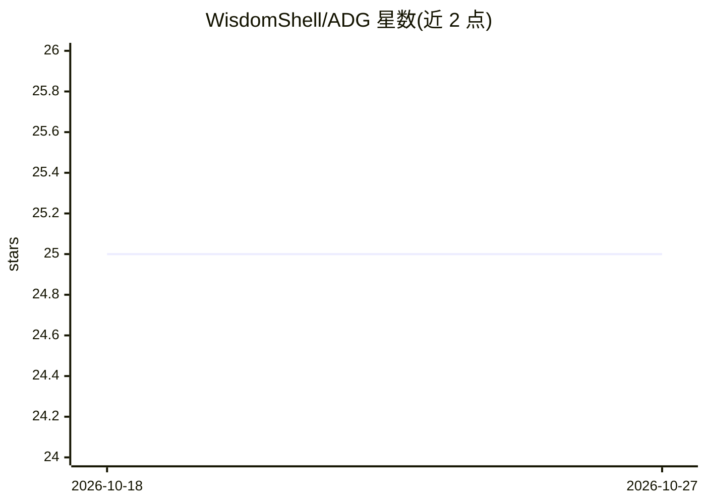

# WisdomShell/ADG

⭐ 25 · Python · 推送 2026-04-14 · [GitHub](https://github.com/WisdomShell/ADG) · 组织维护 · 中文 README

**面向科研的指令数据选择流水线：按答案散度给指令打分选子集**

ACL 2026 论文的官方代码发布：ADG（Answer Divergence-Guided Selection）通过高温采样多条答案、在表示空间中度量散度幅度与形状各向异性，结合语义分箱比例选择，在固定预算下为指令微调挑选子集。仓库提供完整流水线：多样本答案生成（torchrun 分布式）、指令嵌入与聚类、ADG 打分选择（LLaMA/Qwen 两套脚本）、基于 stanford_alpaca 的全量微调训练、lm-evaluation-harness 评测（BBH/GSM8K/MMLU 等 6 项）。多数脚本使用占位路径需手动配置，GPU 显存压力需调 batch size。

## 筛选速览

| 维度 | 判定 | 备注 |
|---|---|---|
| AI 角色 | `ai-ecosystem` | LLM/agent 周边工具 |
| 许可风险 | `none` | — |
| 部署形态 | `library` | 以包/库形式分发 |
| 模型依赖 | — | README 未给出锁定关系 |
| 硬件要求 | — | 无带数字的原话,不猜 |
| 安装摩擦 | `low` | 无编译、无系统依赖或容器化 |
| 成熟度 | — | 结构信号不足 |

## 能力要点

- 多条采样答案的几何结构打分（散度幅度+形状各向异性）
- 语义分箱比例选择避免集中于密集指令区域
- 生成→嵌入聚类→打分→训练→评测的端到端脚本流水线
- LLaMA 与 Qwen 两种 backbone 的专用打分与训练脚本

## 适用场景

- 固定数据预算下为指令微调挑选高价值子集
- 复现论文中三指令池/六基准的实验
- 分析所选子集的任务类型分布

## 场景标签

`微调` `科研工具` · 领域:学习与行业

## 证据(README 行号)

> L13: This repository releases the core pipeline of **Answer Divergence-Guided Selection (ADG)** for instruction data sel
> L27: This repository provides the practical pipeline for:
> L32: - benchmark evaluation,

## 星数曲线

2026-10-18 25 → 2026-10-27 25（+0）

---
*卡片 v1 · prompt 1.4 · 生成 2026-10-27 · 置信度 high · 依据 README sha `0b4744ec58df` · [字段定义](../../DATASET.md)*
