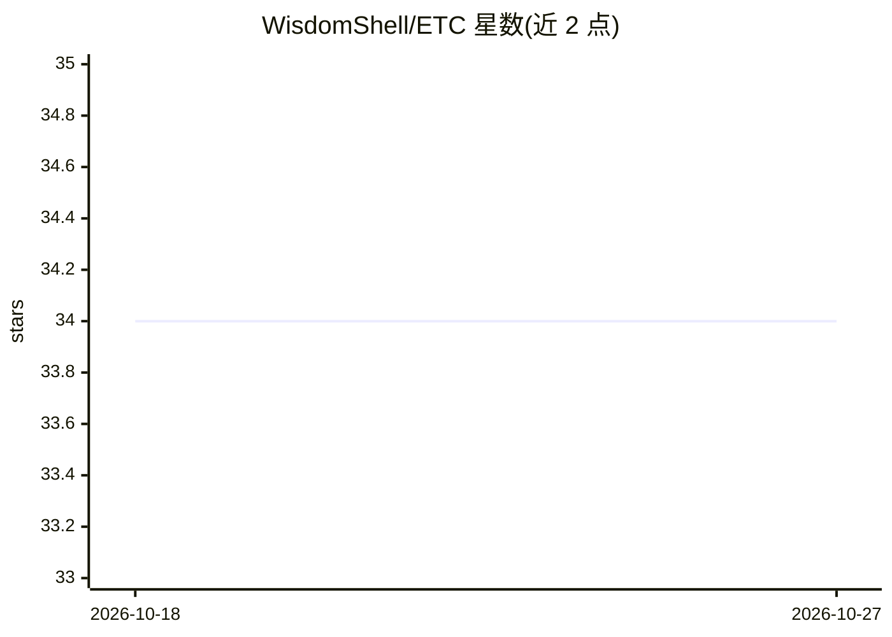

# WisdomShell/ETC

⭐ 34 · Python · MIT · 推送 2026-04-14 · [GitHub](https://github.com/WisdomShell/ETC) · 组织维护 · 中文 README

**AAAI'26 论文 ETC：免训练的动态 RAG 检索时机方法**

发布 AAAI 2026 Oral 论文的官方实现：ETC（Entropy-Trend Constraint）是免训练、即插即用的动态检索增强生成方法，解决‘何时触发检索’问题。机制为在解码过程中计算 token 级熵，构建熵序列并计算一阶、二阶差分，配合动态平滑信号，在不确定性上升时提前触发检索。检索侧使用 Elasticsearch 对维基百科段落建索引，在 2WikiMultihopQA、HotpotQA 等 6 个 QA 基准上评测。提供 main.py 推理入口、索引构建与评估脚本。

## 筛选速览

| 维度 | 判定 | 备注 |
|---|---|---|
| AI 角色 | `ai-ecosystem` | LLM/agent 周边工具 |
| 许可风险 | `permissive` | MIT |
| 部署形态 | `library` | 以包/库形式分发 |
| 模型依赖 | — | README 未给出锁定关系 |
| 硬件要求 | — | 无带数字的原话,不猜 |
| 安装摩擦 | `low` | 无编译、无系统依赖或容器化 |
| 成熟度 | — | 结构信号不足 |

## 能力要点

- 免训练、即插即用，无需额外微调
- 基于熵序列一阶/二阶差分与动态平滑的检索触发
- Elasticsearch 维基百科索引的检索管线
- 在 6 个 QA 基准与多个 LLM 后端上评测

## 适用场景

- 复现论文中动态 RAG 的检索时机实验
- 研究不确定性趋势驱动的检索触发方法
- 在多跳 QA 基准上评测动态 RAG 方法

## 场景标签

`RAG` `模型评测` · 领域:评测与运维

## 证据(README 行号)

> L12: This repository releases the implementation of **ETC** (**E**ntropy-**T**rend **C**onstraint), a training-free meth
> L14: ETC addresses a central problem in dynamic RAG: **when retrieval should be triggered**. Instead of reacting to isol
> L127: ETC is evaluated on six QA benchmarks:

## 星数曲线

2026-10-18 34 → 2026-10-27 34（+0）

---
*卡片 v1 · prompt 1.4 · 生成 2026-10-25 · 置信度 high · 依据 README sha `55ea497ab74a` · [字段定义](../../DATASET.md)*
