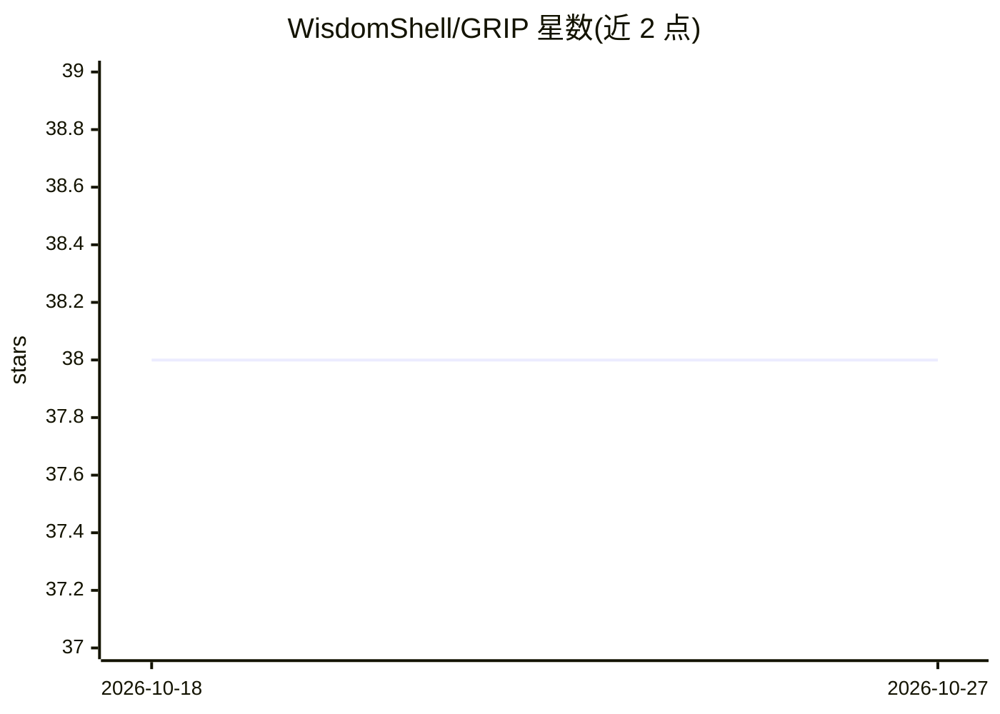

# WisdomShell/GRIP

⭐ 38 · Python · 推送 2026-04-14 · [GitHub](https://github.com/WisdomShell/GRIP) · 组织维护 · 中文 README

**检索即生成框架 GRIP：模型在解码中自主决定何时检索**

ACL 2026 Main Conference 论文的官方代码库，发布 GRIP（Generation-guided Retrieval with Information Planning）的核心代码、训练流程、推理脚本与评测工具。GRIP 将检索控制内化到 token 级解码，通过 [RETRIEVE]/[INTERMEDIARY]/[ANSWER]/[SOLVED] 控制token，由模型自行决定何时检索、如何改写查询与何时终止。仓库提供结构化训练数据构建（依赖 Elasticsearch Wikipedia 索引与 OpenAI 兼容 API）、LLaMA 骨干的 SFT 与 DAPO RL 微调、本地多步推理及 EM/F1/ROUGE 评测，并发布 GRIP-Llama-3-8B 模型与 SFT/RL 数据集。

## 筛选速览

| 维度 | 判定 | 备注 |
|---|---|---|
| AI 角色 | `ai-native` | 本体是模型或模型工具 |
| 许可风险 | `none` | — |
| 部署形态 | `library` | 以包/库形式分发 |
| 模型依赖 | — | README 未给出锁定关系 |
| 硬件要求 | — | 无带数字的原话,不猜 |
| 安装摩擦 | `low` | 无编译、无系统依赖或容器化 |
| 成熟度 | — | 结构信号不足 |

## 能力要点

- 检索时机、查询改写与停止均以可训练控制token表示
- 四类结构化监督训练数据（直答/触发检索/多跳规划/答案合成）
- 提供 SFT 与 DAPO 规则 RL 微调脚本（LLaMA 骨干）
- 发布 GRIP-Llama-3-8B 模型与 SFT/RL 数据集

## 适用场景

- 复现论文的动态 RAG 训练与推理流程
- 构建自主决定检索时机的多跳问答模型
- 在 QA 基准上评测 token 级检索控制行为

## 场景标签

`RAG` `微调` `强化学习` · 领域:知识与检索

## 证据(README 行号)

> L15: This repository releases the core code, training pipeline, inference scripts, and evaluation utilities for **GRIP**
> L17: Instead of treating retrieval as an external controller decision, GRIP internalizes retrieval behavior into token-l
> L37: - rule-based RL fine-tuning with DAPO,

## 星数曲线

2026-10-18 38 → 2026-10-27 38（+0）

---
*卡片 v1 · prompt 1.4 · 生成 2026-10-25 · 置信度 high · 依据 README sha `3b2efc29273b` · [字段定义](../../DATASET.md)*
