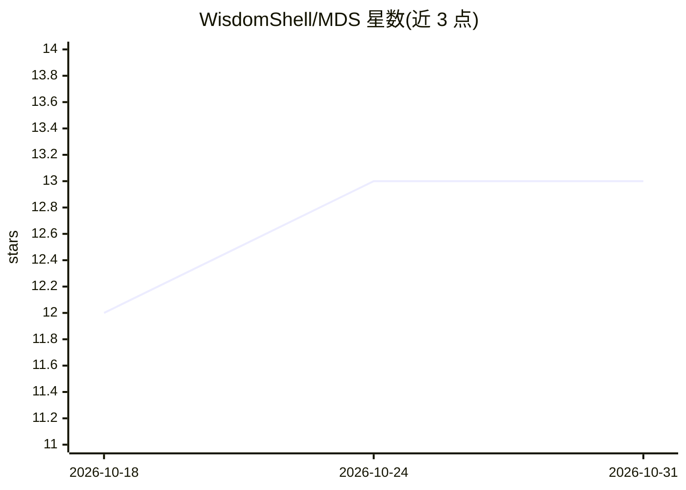

# WisdomShell/MDS

⭐ 13 · Python · 推送 2026-04-14 · [GitHub](https://github.com/WisdomShell/MDS) · 组织维护 · 中文 README

**多轮对话指令微调的数据选择与评测流水线**

ACL 2026 Findings 论文的官方代码仓库，发布多轮对话指令微调的两阶段数据选择方法 MDS：全局阶段在用户查询轨迹空间聚类并做带冗余控制的候选筛选，局部阶段用对话级结构化打分做预算式最终选择。仓库含选择脚本、转换为 disk-style 训练数据的脚本、统一评测脚本及训练/评测数据集。注意：模型训练与推理代码不包含，需用常规 SFT/LoRA 框架自行完成；GPT 类评测指标需配置有效 API。面向做对话微调数据筛选与评测的研究者和开发者。

## 筛选速览

| 维度 | 判定 | 备注 |
|---|---|---|
| AI 角色 | `ai-ecosystem` | LLM/agent 周边工具 |
| 许可风险 | `none` | — |
| 部署形态 | `library` | 以包/库形式分发 |
| 模型依赖 | — | README 未给出锁定关系 |
| 硬件要求 | — | 无带数字的原话,不猜 |
| 安装摩擦 | `low` | 无编译、无系统依赖或容器化 |
| 成熟度 | — | 结构信号不足 |

## 能力要点

- 两阶段选择：用户查询轨迹空间聚类 + 对话级结构化打分
- 统一评测脚本支持 LLM-EVAL/G-EVAL/Entity-F1 及 BLEU-3/ROUGE-L 等本地指标
- 附带训练与评测数据集（Baize、Banking 等 JSONL 文件）
- 训练与预测代码不随仓库发布，需配合常规 SFT/LoRA 框架使用

## 适用场景

- 从多轮对话语料池中筛选高质量微调子集
- 对多轮对话模型预测文件做多指标统一评测
- 将选出的对话展开为逐轮监督样本用于 SFT

## 场景标签

`微调` `模型评测` · 领域:评测与运维

## 证据(README 行号)

> L11: This repository releases the core data selection and evaluation pipeline used in our work on multi-turn dialogue in
> L22: Multi-turn dialogue corpora are often noisy and structurally inconsistent. Compared with single-turn instruction da

## 星数曲线

2026-10-18 12 → 2026-10-31 13（+1）

---
*卡片 v1 · prompt 1.4 · 生成 2026-10-31 · 置信度 high · 依据 README sha `b6aa14417ce9` · [字段定义](../../DATASET.md)*
