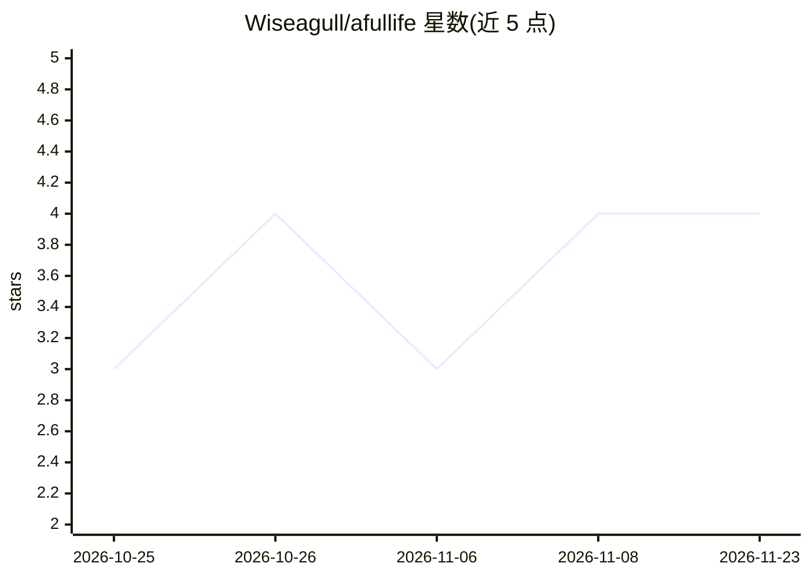

# Wiseagull/afullife

⭐ 4 · JavaScript · MIT · 推送 2026-11-06 · [GitHub](https://github.com/Wiseagull/afullife) · 个人维护 · 中文 README

**为 QQ 机器人赋予持久身份与记忆的自托管桥接系统**

AFULLIFE 是一个桥接 QQ 与 DSH（DeepSeek Harness）的自托管项目：通过 SnowLuma（OneBot v11 实现）收发 QQ 消息，把同一份身份与记忆扩展到 QQ 等多个通道。核心机制包括：只追加的事件流作为唯一真相、从中蒸馏出的记忆条目（可合并/降级/待确认）、三层人格文件（self.md 归机器人自己写）、45 分钟一轮的自由活动、小本本与兴趣账本、QQ 空间文字说说，以及用量面板。依赖 DSH≥0.2.1-rc.2、SnowLuma 与 Node 22+；README 明示第三方协议实现存在封号风险。

## 筛选速览

| 维度 | 判定 | 备注 |
|---|---|---|
| AI 角色 | `ai-native` | 本体是模型或模型工具 |
| 许可风险 | `permissive` | MIT |
| 部署形态 | `None` |  |
| 模型依赖 | locked-api |  |
| 硬件要求 | — | 无带数字的原话,不猜 |
| 安装摩擦 | `low` | 无编译、无系统依赖或容器化 |
| 成熟度 | — | 结构信号不足 |

## 能力要点

- 事件流只追加、作为跨通道唯一真相，记忆从中蒸馏并带来源事件 id
- 人格三层文件：core.md/group.md/self.md，其中 self.md 可由机器人自己写入
- 自由活动：机器人自行决定一拍一拍做什么；配小本本与兴趣账本
- doctor 自检脚本与 update 脚本，更新不触碰 data/persona/notebook

## 适用场景

- 给 QQ 群/私聊里的 bot 配一套跨会话、可体检的持久记忆
- 让 bot 拥有自主活动时段、自己记录笔记与待办
- 本地自托管场景下让 bot 读屏幕、开浏览器、改文件

## 场景标签

`聊天机器人` `Agent 记忆` · 领域:Agent 开发

## 证据(README 行号)

> L49: - 它通过 SnowLuma 这类 OneBot v11 实现与 QQ 通信，
> L65: ### 1. 事件流是唯一真相，记忆不是"塞进提示词的聊天记录"
> L86: - **自由活动**：一段 45 分钟（可调）里，她一拍一拍地醒来，自己决定做什么、说几句、还是安静待着；

## 星数曲线

2026-10-25 3 → 2026-11-23 4（+1）

---
*卡片 v1 · prompt 1.4 · 生成 2026-11-21 · 置信度 high · 依据 README sha `a79033661b0b` · [字段定义](../../DATASET.md)*
