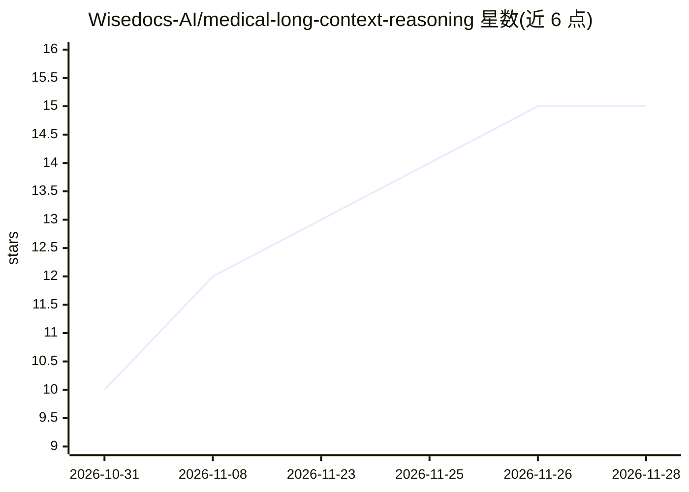

# Wisedocs-AI/medical-long-context-reasoning

⭐ 15 · Python · 推送 2026-08-31 · [GitHub](https://github.com/Wisedocs-AI/medical-long-context-reasoning) · [官网](https://www.wisedocs.ai/blogs/medical-long-context-reasoning) · 组织维护

**评测 LLM 长文本医学文档推理能力的基准与评测框架**

MLCR 是一个配置驱动的基准与评测框架，衡量 LLM 在真实文档被无关填充材料稀释后的准确率保持情况。Runner 按 cases×prompts×models×modalities×filler ratios×thinking levels 构建笛卡尔测试矩阵，确定性插入填充上下文，逐格调用模型并写出结构化结果；Scorer 用 3 模型多数投票的 LLM-as-a-Judge 管线对照 ground-truth 打分。数据集托管在 Hugging Face，需 CLI 下载初始化；凭据通过 .env 配置 GCP/Azure。

## 筛选速览

| 维度 | 判定 | 备注 |
|---|---|---|
| AI 角色 | `ai-ecosystem` | LLM/agent 周边工具 |
| 许可风险 | `none` | — |
| 部署形态 | `library` | 以包/库形式分发 |
| 模型依赖 | locked-api |  |
| 硬件要求 | — | 无带数字的原话,不猜 |
| 安装摩擦 | `low` | 无编译、无系统依赖或容器化 |
| 成熟度 | — | 结构信号不足 |

## 能力要点

- 笛卡尔测试矩阵（cases×prompts×models×modalities×filler ratios×thinking levels）自动扫掠
- 基于 blake2b 种子的确定性填充插入，结果可复现、可跨模型比较
- 3 模型多数投票 LLM-as-a-Judge 评分管线（Gate 0 简洁性 + Gate 1 完整性/准确性）
- 行级 result.json 断点续跑与失败重试

## 适用场景

- 评测模型在长医学理赔文件被噪声稀释后的问答准确率
- 对 OCR/病历类文档任务做多模型、多填充比例的系统扫掠实验
- 用 LLM-as-a-Judge 对已完成的评测运行批量打分

## 场景标签

`模型评测` · 领域:评测与运维

## 证据(README 行号)

> L3: A config-driven framework for evaluating how well LLMs preserve accuracy when
> L40: |**Runner**|`src/mlcr/`|Core evaluation engine — builds test matrices, manages filler interleaving, calls providers
> L41: |**Scorer**|`src/mlcr/scoring.py`|Multi-gate LLM-as-a-Judge evaluation pipeline|Grading model responses against gro

## 星数曲线

2026-10-31 10 → 2026-11-28 15（+5）

---
*卡片 v1 · prompt 1.4 · 生成 2026-11-18 · 置信度 high · 依据 README sha `b7b9cf302a96` · [字段定义](../../DATASET.md)*
