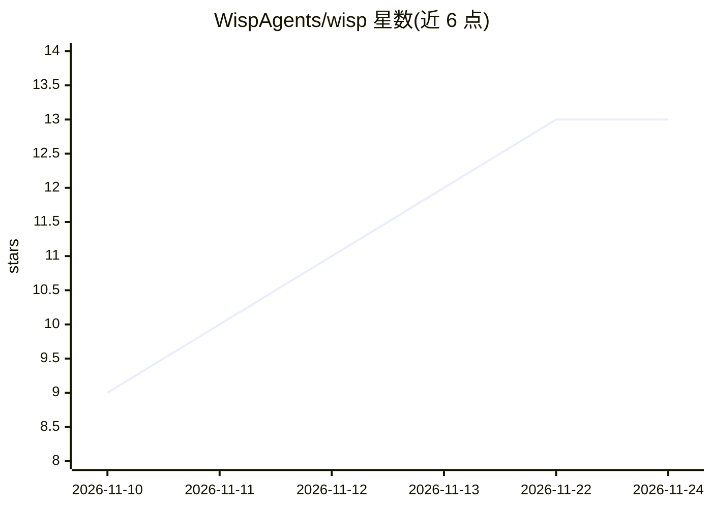

# WispAgents/wisp

⭐ 14 · Rust · MIT · 推送 2026-11-23 · [GitHub](https://github.com/WispAgents/wisp) · [官网](https://trywisp.dev/) · 组织维护

**在后台并行运行编码 Agent，交付一屏报告而非完整转录**

桌面/浏览器应用：把 Claude Code、Codex 等 agent harness 发到后台运行，任务在 git worktree 中隔离并行执行，完成后渲染成含 diff、测试结果、提交与决策的结构化报告。用户可追问、接管终端会话、一键开 PR、跨任务跨仓库并行，支持 GitHub/Linear 工单入口、Crew 常驻 agent 与按历史学习自动选择 harness。依赖至少一个已登录的 agent CLI（或桌面应用内置 CLI）。

## 筛选速览

| 维度 | 判定 | 备注 |
|---|---|---|
| AI 角色 | `ai-ecosystem` | LLM/agent 周边工具 |
| 许可风险 | `permissive` | MIT |
| 部署形态 | `desktop` | 安装包/桌面程序 |
| 模型依赖 | — | README 未给出锁定关系 |
| 硬件要求 | — | 无带数字的原话,不猜 |
| 安装摩擦 | `low` | 无编译、无系统依赖或容器化 |
| 成熟度 | — | 结构信号不足 |

## 能力要点

- 后台并行运行多种 agent harness，完成后输出结构化 presentation 报告
- 每任务独立 git worktree，跨仓库任务各开 PR，Ship it 一键提交/推送/开 PR
- Crew 常驻 agent 与 Auto 模式按历史表现自动选 harness/模型
- 变更 harness 版本校验（sha256）与仓库 hooks/MCP 服务器运行前确认

## 适用场景

- 同时给多个编码 agent 派活而不逐个盯转录
- 从 GitHub/Linear issue 一键生成修复任务并开 PR
- 合并前让另一个 harness 交叉审查 PR

## 场景标签

`编码 Agent` `多智能体` `代码审查` · 领域:Agent 开发

## 证据(README 行号)

> L89: Agent transcripts are long, and you rarely need them. wisp runs agent harnesses (Claude Code, Codex, opencode, Curs
> L116: |**Any harness**|Claude Code, Codex, opencode, Cursor CLI, Antigravity CLI, Grok Build, or GitHub Copilot CLI. Pic

## 星数曲线

2026-11-10 9 → 2026-11-24 13（+4）

---
*卡片 v1 · prompt 1.4 · 生成 2026-11-18 · 置信度 high · 依据 README sha `940c8c70d456` · [字段定义](../../DATASET.md)*
