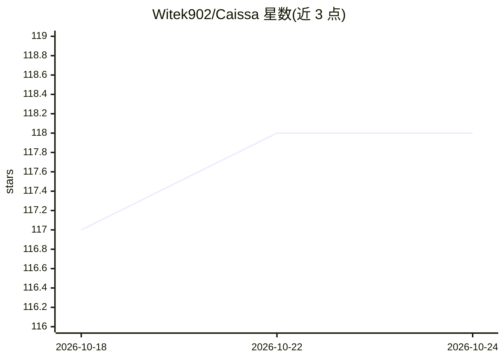

# Witek902/Caissa

⭐ 118 · C++ · MIT · 推送 2026-10-21 · [GitHub](https://github.com/Witek902/Caissa) · 个人维护

**C++ 编写的 UCI 国际象棋引擎，NNUE 神经网络评估**

由 Michał Witanowski 自 2021 年起从零编写的 UCI 兼容国际象棋引擎，MIT 许可。核心机制：自定义 NNUE 式双视角神经网络评估，训练数据来自 20.5+ 亿自我对弈局面；搜索采用 Negamax、PVS、LMR 等剪枝技术；支持 Syzygy 残局库（7 子）、Chess960 与 DFRC 变体；提供 AVX-512/AVX2/BMI2/NEON 等 SIMD 手写优化与多线程搜索。Releases 页提供按 CPU 架构区分的预编译可执行文件，也可用 Makefile/CMake/Visual Studio 从源码构建，网络权重文件构建时自动下载。

## 筛选速览

| 维度 | 判定 | 备注 |
|---|---|---|
| AI 角色 | `ai-native` | 本体是模型或模型工具 |
| 许可风险 | `permissive` | MIT |
| 部署形态 | `desktop` | 安装包/桌面程序 |
| 模型依赖 | — | README 未给出锁定关系 |
| 硬件要求 | — | 无带数字的原话,不猜 |
| 安装摩擦 | `high` | 编译与系统依赖俱全 |
| 成熟度 | — | 结构信号不足 |

## 能力要点

- 自定义 NNUE 神经网络评估，20.5+ 亿自弈局面训练
- Syzygy 残局库支持（最多 7 子）与 FRC/DFRC 变体
- 手写 SIMD：AVX-512(VNNI/VBMI2)/AVX2/SSE4/ARM NEON 加标量回退
- Releases 提供按 CPU 架构区分的预编译二进制

## 适用场景

- 在 UCI 兼容国际象棋 GUI 中作为对弈引擎
- 国际象棋局面分析与多线路 MultiPV 分析
- 搭配 Syzygy 残局库做精确残局研究

## 场景标签

 · 领域:游戏 AI/国际象棋引擎

## 证据(README 行号)

> L13: **Caissa** is a strong, UCI-compatible chess engine written from scratch in C++ since early 2021 by Michał Witanows
> L56: - ✅ **Neural Network Evaluation** — custom NNUE-style evaluation, see Neural Network
> L99: - **Custom CUDA Trainer** written from scratch, using AdamW optimizer

## 星数曲线

2026-10-18 117 → 2026-10-24 118（+1）

---
*卡片 v1 · prompt 1.4 · 生成 2026-10-23 · 置信度 high · 依据 README sha `62cd76dc064b` · [字段定义](../../DATASET.md)*
